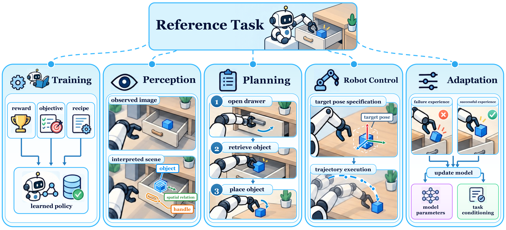
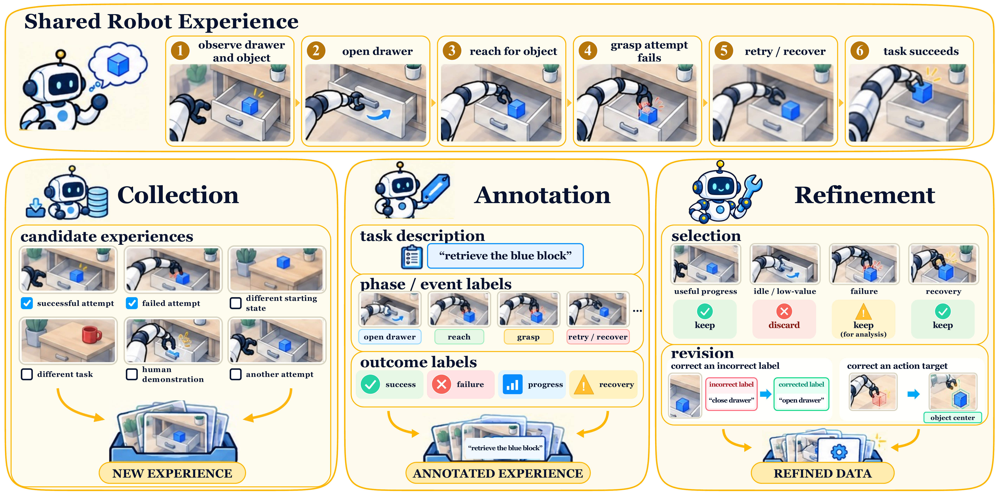
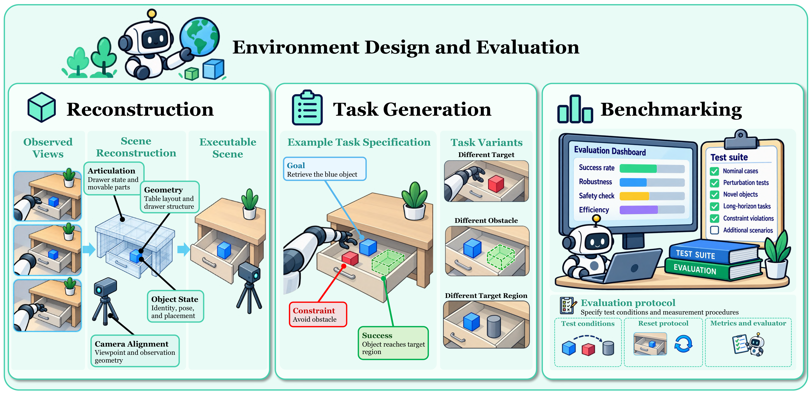
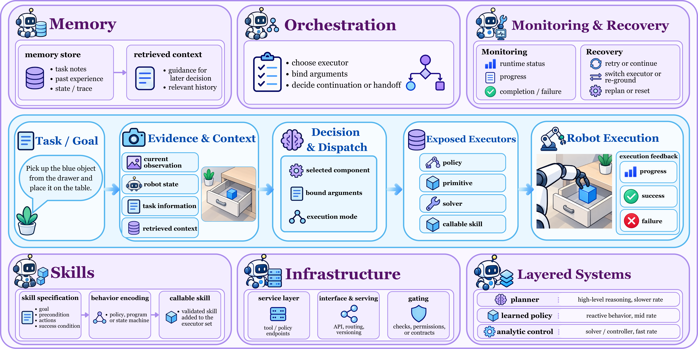

<h1 align="center">Awesome Agentic Robots</h1>

  
  
  
  

<!-- Add the author-confirmed arXiv link to its badge upon release. -->

Official companion repository for **Towards Agentic Robots: Model, Data, Environment, and Harness**, with papers and code on agentic robots.

[Taxonomy](#taxonomy) · [Papers](#papers) · [Contributing](CONTRIBUTING.md)

## Overview

Agentic robots use foundation models to guide robot execution and learning. We organize this work around **Model**, **Data**, **Environment**, and **Harness**, connecting model decisions, data pipelines, environments, and the orchestration of robot capabilities.

## Taxonomy

| Domain | Categories |
| --- | --- |
| **Model** | [Training](#training) · [Perception](#perception) · [Planning](#planning) · [Robot Control](#robot-control) · [Adaptation](#adaptation) |
| **Data** | [Collection](#collection) · [Annotation](#annotation) · [Refinement](#refinement) |
| **Environment** | [Reconstruction](#reconstruction) · [Task Generation](#task-generation) · [Benchmarking](#benchmarking) |
| **Harness** | [Orchestration](#orchestration) · [Memory](#memory) · [Monitoring and Recovery](#monitoring-and-recovery) · [Skills](#skills) · [Infrastructure](#infrastructure) · [Layered Systems](#layered-systems) |

## Papers

<!-- BEGIN AUTO-GENERATED PAPER LIST -->

### Model

#### Model · Training

<table width="100%">
<thead><tr>
<th width="89%" align="left">Paper Title</th>
<th width="11%" align="center" nowrap>Code</th>
</tr></thead>
<tbody>
<tr><td><a href="https://proceedings.iclr.cc/paper_files/paper/2024/hash/70c26937fbf3d4600b69a129031b66ec-Abstract-Conference.html">Eureka: Human-Level Reward Design via Coding Large Language Models</a></td><td align="center" nowrap><a href="https://github.com/eureka-research/Eureka"><picture><source media="(prefers-color-scheme: dark)" srcset="assets/icons/github-dark.svg"></picture></a></td></tr>
<tr><td><a href="https://arxiv.org/abs/2603.27416v1">Agent-Driven Autonomous Reinforcement Learning Research: Iterative Policy Improvement for Quadruped Locomotion</a></td><td align="center" nowrap>—</td></tr>
<tr><td><a href="https://arxiv.org/abs/2605.00416v4">Learning While Deploying: Fleet-Scale Reinforcement Learning for Generalist Robot Policies</a></td><td align="center" nowrap>—</td></tr>
<tr><td><a href="https://arxiv.org/abs/2605.11859v1">EvoNav: Evolutionary Reward Function Design for Robot Navigation with Large Language Models</a></td><td align="center" nowrap>—</td></tr>
<tr><td><a href="https://arxiv.org/abs/2605.11665v1">Nautilus: From One Prompt to Plug-and-Play Robot Learning</a></td><td align="center" nowrap>—</td></tr>
<tr><td><a href="https://rlj.cs.umass.edu/2026/papers/Paper12.html">From Demonstrations to Rewards: Test-Time Prompt Optimization for VLM Reward Models</a></td><td align="center" nowrap><a href="https://github.com/cgumbsch/Demo2Reward"><picture><source media="(prefers-color-scheme: dark)" srcset="assets/icons/github-dark.svg"></picture></a></td></tr>
<tr><td><a href="https://rlj.cs.umass.edu/2026/papers/Paper81.html">Reward Design Agent for Reinforcement Learning</a></td><td align="center" nowrap>—</td></tr>
<tr><td><a href="https://arxiv.org/abs/2606.08610">HARBOR: A Harness Framework for Agentic Robot Reinforcement Learning</a></td><td align="center" nowrap><a href="https://github.com/supersglzc/harbor-rl"><picture><source media="(prefers-color-scheme: dark)" srcset="assets/icons/github-dark.svg"></picture></a></td></tr>
<tr><td><a href="https://arxiv.org/abs/2606.09630v1">ReCoVLA: VLM-Guided Reward Compilation for Failure Recovery in Vision-Language-Action Policies</a></td><td align="center" nowrap>—</td></tr>
<tr><td><a href="https://arxiv.org/abs/2606.19980v2">ENPIRE: Agentic Robot Policy Self-Improvement in the Real World</a></td><td align="center" nowrap><a href="https://github.com/NVlabs/ENPIRE"><picture><source media="(prefers-color-scheme: dark)" srcset="assets/icons/github-dark.svg"></picture></a></td></tr>
<tr><td><a href="https://arxiv.org/abs/2606.22142v1">RoboLineage: Agent-Native Data Lifecycle Governance Across Robot Policy Iterations</a></td><td align="center" nowrap><a href="https://github.com/robolineage/robolineage"><picture><source media="(prefers-color-scheme: dark)" srcset="assets/icons/github-dark.svg"></picture></a></td></tr>
<tr><td><a href="https://arxiv.org/abs/2606.23280v1">Causal Reward World Models: Zero-shot Reward Design for Automated Skill Generation</a></td><td align="center" nowrap>—</td></tr>
<tr><td><a href="https://arxiv.org/abs/2608.07555v1">You Don&#x27;t Need To Stay in The Loop: An Agentic Robotics Loop for Robot-Policy Improvement</a></td><td align="center" nowrap>—</td></tr>
<tr><td><a href="https://arxiv.org/abs/2609.01281v1">EmbodiedSkills: A Unified Framework for Orchestrating, Training, and Deploying VLA Agents</a></td><td align="center" nowrap><a href="https://github.com/ZJU4EmbodiedAI/EmbodiedSkills"><picture><source media="(prefers-color-scheme: dark)" srcset="assets/icons/github-dark.svg"></picture></a></td></tr>
<tr><td><a href="https://arxiv.org/abs/2609.17210v1">FluxVLA Engine: A One-Stop VLA Engineering Platform for Embodied Intelligence</a></td><td align="center" nowrap><a href="https://github.com/FluxVLA/FluxVLA"><picture><source media="(prefers-color-scheme: dark)" srcset="assets/icons/github-dark.svg"></picture></a></td></tr>
</tbody>
</table>

#### Model · Perception

<table width="100%">
<thead><tr>
<th width="89%" align="left">Paper Title</th>
<th width="11%" align="center" nowrap>Code</th>
</tr></thead>
<tbody>
<tr><td><a href="https://proceedings.neurips.cc/paper_files/paper/2025/hash/6ea83df350753236215cbf2fe9716eca-Abstract-Conference.html">SoFar: Language-Grounded Orientation Bridges Spatial Reasoning and Object Manipulation</a></td><td align="center" nowrap><a href="https://github.com/qizekun/SoFar"><picture><source media="(prefers-color-scheme: dark)" srcset="assets/icons/github-dark.svg"></picture></a></td></tr>
<tr><td><a href="https://arxiv.org/abs/2601.14681v1">FARE: Fast-Slow Agentic Robotic Exploration</a></td><td align="center" nowrap>—</td></tr>
<tr><td><a href="https://arxiv.org/abs/2602.04157v1">A Modern System Recipe for Situated Embodied Human-Robot Conversation with Real-Time Multimodal LLMs and Tool-Calling</a></td><td align="center" nowrap>—</td></tr>
<tr><td><a href="https://www.roboticsproceedings.org/rss22/p074.html">Steerable Vision-Language-Action Policies for Embodied Reasoning and Hierarchical Control</a></td><td align="center" nowrap><a href="https://github.com/steerable-policies/steerable-policies-bridge"><picture><source media="(prefers-color-scheme: dark)" srcset="assets/icons/github-dark.svg"></picture></a></td></tr>
<tr><td><a href="https://www.roboticsproceedings.org/rss22/p067.html">OpenFrontier: General Navigation with Visual-Language Grounded Frontiers</a></td><td align="center" nowrap><a href="https://github.com/cvg/OpenFrontier"><picture><source media="(prefers-color-scheme: dark)" srcset="assets/icons/github-dark.svg"></picture></a></td></tr>
<tr><td><a href="https://arxiv.org/abs/2603.18210v1">GoalVLM: VLM-driven Object Goal Navigation for Multi-Agent System</a></td><td align="center" nowrap>—</td></tr>
<tr><td><a href="https://arxiv.org/abs/2604.26988v1">Robot Planning and Situation Handling with Active Perception</a></td><td align="center" nowrap><a href="https://github.com/aoloo-r/VAP-TAMP"><picture><source media="(prefers-color-scheme: dark)" srcset="assets/icons/github-dark.svg"></picture></a></td></tr>
<tr><td><a href="https://doi.org/10.1145/3757279.3785641">SCOPE: Real-Time Natural Language Camera Agent at the Edge</a></td><td align="center" nowrap><a href="https://github.com/HindsboNikolaj/SCOPE"><picture><source media="(prefers-color-scheme: dark)" srcset="assets/icons/github-dark.svg"></picture></a></td></tr>
<tr><td><a href="https://arxiv.org/abs/2606.06061v1">A Conversational Framework for Human-Robot Collaborative Manipulation with Distributed Generative AI models</a></td><td align="center" nowrap><a href="https://github.com/cogrob-tuni/franka-llm"><picture><source media="(prefers-color-scheme: dark)" srcset="assets/icons/github-dark.svg"></picture></a></td></tr>
<tr><td><a href="https://arxiv.org/abs/2606.10577v3">AgenticNav: Zero-Shot Vision-and-Language Navigation as a Tool-Calling Harness</a></td><td align="center" nowrap>—</td></tr>
<tr><td><a href="https://www.roboticsproceedings.org/rss22/p095.html">RoboVista: Evaluating Vision Language Models for Diverse Robot Applications</a></td><td align="center" nowrap><a href="https://github.com/ehehee/robovista"><picture><source media="(prefers-color-scheme: dark)" srcset="assets/icons/github-dark.svg"></picture></a></td></tr>
<tr><td><a href="https://arxiv.org/abs/2607.10383v3">ABot-N1: Toward a General Visual Language Navigation Foundation Model</a></td><td align="center" nowrap><a href="https://github.com/amap-cvlab/ABot-Navigation"><picture><source media="(prefers-color-scheme: dark)" srcset="assets/icons/github-dark.svg"></picture></a></td></tr>
<tr><td><a href="https://arxiv.org/abs/2608.17129v2">MG-VQA: Manipulation Grounded Visual Question Answering with VLMs</a></td><td align="center" nowrap><a href="https://github.com/vineet2104/MG-VQA"><picture><source media="(prefers-color-scheme: dark)" srcset="assets/icons/github-dark.svg"></picture></a></td></tr>
<tr><td><a href="https://arxiv.org/abs/2609.02653v2">HINT: Human-Intent Inception for Long-Horizon Robot Manipulation</a></td><td align="center" nowrap><a href="https://github.com/robot-hint/HINT"><picture><source media="(prefers-color-scheme: dark)" srcset="assets/icons/github-dark.svg"></picture></a></td></tr>
<tr><td><a href="https://arxiv.org/abs/2609.12285v1">AnchorVLN: Geometry-Anchored Vision-Language Grounding Reasoning for Open-Vocabulary Navigation</a></td><td align="center" nowrap><a href="https://github.com/aryanmangal769/embodied-nav-mcp"><picture><source media="(prefers-color-scheme: dark)" srcset="assets/icons/github-dark.svg"></picture></a></td></tr>
<tr><td><a href="https://arxiv.org/abs/2609.20615v1">INSPECT: Learning Robot View Selection from Assistant Use</a></td><td align="center" nowrap><a href="https://github.com/Kratos-Wen/INSPECT"><picture><source media="(prefers-color-scheme: dark)" srcset="assets/icons/github-dark.svg"></picture></a></td></tr>
<tr><td><a href="https://arxiv.org/abs/2609.27720v1">CoRelNav: Collaborative Relational Navigation for Multi-Robot Spatially Constrained Semantic Navigation</a></td><td align="center" nowrap>—</td></tr>
<tr><td><a href="https://arxiv.org/abs/2609.29389v1">Robo-Harness K1: Harnessing Robot-Use Agents via Perception Augmentation</a></td><td align="center" nowrap><a href="https://github.com/Robo-Harness/k1"><picture><source media="(prefers-color-scheme: dark)" srcset="assets/icons/github-dark.svg"></picture></a></td></tr>
</tbody>
</table>

#### Model · Planning

<table width="100%">
<thead><tr>
<th width="89%" align="left">Paper Title</th>
<th width="11%" align="center" nowrap>Code</th>
</tr></thead>
<tbody>
<tr><td><a href="https://proceedings.mlr.press/v229/ren23a.html">Robots That Ask For Help: Uncertainty Alignment for Large Language Model Planners</a></td><td align="center" nowrap><a href="https://github.com/google-research/google-research/tree/master/language_model_uncertainty"><picture><source media="(prefers-color-scheme: dark)" srcset="assets/icons/github-dark.svg"></picture></a></td></tr>
<tr><td><a href="https://proceedings.mlr.press/v229/rana23a.html">SayPlan: Grounding Large Language Models using 3D Scene Graphs for Scalable Robot Task Planning</a></td><td align="center" nowrap>—</td></tr>
<tr><td><a href="https://ieeexplore.ieee.org/document/10610855/">RoCo: Dialectic Multi-Robot Collaboration with Large Language Models</a></td><td align="center" nowrap><a href="https://github.com/MandiZhao/robot-collab"><picture><source media="(prefers-color-scheme: dark)" srcset="assets/icons/github-dark.svg"></picture></a></td></tr>
<tr><td><a href="https://proceedings.mlr.press/v305/feng25b.html">Reflective Planning: Vision-Language Models for Multi-Stage Long-Horizon Robotic Manipulation</a></td><td align="center" nowrap><a href="https://github.com/yunhaif/reflect-vlm"><picture><source media="(prefers-color-scheme: dark)" srcset="assets/icons/github-dark.svg"></picture></a></td></tr>
<tr><td><a href="https://proceedings.mlr.press/v267/shi25d.html">Hi Robot: Open-Ended Instruction Following with Hierarchical Vision-Language-Action Models</a></td><td align="center" nowrap>—</td></tr>
<tr><td><a href="https://arxiv.org/abs/2510.03342v3">Gemini Robotics 1.5: Pushing the Frontier of Generalist Robots with Advanced Embodied Reasoning, Thinking, and Motion Transfer</a></td><td align="center" nowrap>—</td></tr>
<tr><td><a href="https://arxiv.org/abs/2601.11063v2">EmboTeam: Grounding LLM Reasoning into Reactive Behavior Trees via PDDL for Embodied Multi-Robot Collaboration</a></td><td align="center" nowrap>—</td></tr>
<tr><td><a href="https://arxiv.org/abs/2601.18492v1">DV-VLN: Dual Verification for Reliable LLM-Based Vision-and-Language Navigation</a></td><td align="center" nowrap><a href="https://github.com/PlumJun/DV-VLN"><picture><source media="(prefers-color-scheme: dark)" srcset="assets/icons/github-dark.svg"></picture></a></td></tr>
<tr><td><a href="https://ojs.aaai.org/index.php/AAAI-SS/article/view/42578">Agentic AI for Robot Control: Flexible but still Fragile</a></td><td align="center" nowrap>—</td></tr>
<tr><td><a href="https://arxiv.org/abs/2602.13591v1">AgentRob: From Virtual Forum Agents to Hijacked Physical Robots</a></td><td align="center" nowrap><a href="https://github.com/PKU-LLM-DS-LAB/AgentRob"><picture><source media="(prefers-color-scheme: dark)" srcset="assets/icons/github-dark.svg"></picture></a></td></tr>
<tr><td><a href="https://arxiv.org/abs/2602.21198v3">Learning from Trials and Errors: Reflective Test-Time Planning for Embodied LLMs</a></td><td align="center" nowrap><a href="https://github.com/Reflective-Test-Time-Planning/Reflective-Test-Time-Planning"><picture><source media="(prefers-color-scheme: dark)" srcset="assets/icons/github-dark.svg"></picture></a></td></tr>
<tr><td><a href="https://arxiv.org/abs/2602.21670v2">Hierarchical LLM-Based Multi-Agent Framework with Prompt Optimization for Multi-Robot Task Planning</a></td><td align="center" nowrap>—</td></tr>
<tr><td><a href="https://arxiv.org/abs/2603.03148v1">From Language to Action: Can LLM-Based Agents Be Used for Embodied Robot Cognition?</a></td><td align="center" nowrap><a href="https://github.com/ShinasShaji/llm-robot-cognition"><picture><source media="(prefers-color-scheme: dark)" srcset="assets/icons/github-dark.svg"></picture></a></td></tr>
<tr><td><a href="https://arxiv.org/abs/2603.02669v1">IMR-LLM: Industrial Multi-Robot Task Planning and Program Generation using Large Language Models</a></td><td align="center" nowrap>—</td></tr>
<tr><td><a href="https://arxiv.org/abs/2603.02772v2">Self-Evolutionary Replanning for Failure-Aware Motion Planning</a></td><td align="center" nowrap>—</td></tr>
<tr><td><a href="https://arxiv.org/abs/2604.13533v2">Evolvable Embodied Agent for Robotic Manipulation via Long Short-Term Reflection and Optimization</a></td><td align="center" nowrap>—</td></tr>
<tr><td><a href="https://arxiv.org/abs/2606.27871v1">LocalNav: Distilling Frontier VLMs and Embodied RL for On-Device Object Goal Navigation</a></td><td align="center" nowrap>—</td></tr>
<tr><td><a href="https://www.roboticsproceedings.org/rss22/p181.html">Hypothesis-driven Model Expansion under Uncertainty for Open-World Robot Planning</a></td><td align="center" nowrap><a href="https://github.com/threefruits/HUME"><picture><source media="(prefers-color-scheme: dark)" srcset="assets/icons/github-dark.svg"></picture></a></td></tr>
<tr><td><a href="https://arxiv.org/abs/2607.22999v2">WCM: World-Cognition Model for Generalizable Human-Robot Interaction</a></td><td align="center" nowrap>—</td></tr>
<tr><td><a href="https://www.frontiersin.org/journals/computer-science/articles/10.3389/fcomp.2026.1848830/full">STARS: extending interactive task learning with large language models</a></td><td align="center" nowrap><a href="https://github.com/Center-for-Integrated-Cognition/STARS"><picture><source media="(prefers-color-scheme: dark)" srcset="assets/icons/github-dark.svg"></picture></a></td></tr>
<tr><td><a href="https://arxiv.org/abs/2608.28300v1">MaCoPlanner: LLM-Assisted Manual-Compiled Task Planning with Proactive Safety Verification for Robotic Industrial Panel Operation</a></td><td align="center" nowrap><a href="https://github.com/XinGP/MaCoPlanner"><picture><source media="(prefers-color-scheme: dark)" srcset="assets/icons/github-dark.svg"></picture></a></td></tr>
<tr><td><a href="https://arxiv.org/abs/2608.30396v1">Scaffolding Foundation Models into Physical-World Agents Pushes the Frontier of Long-Horizon Navigation</a></td><td align="center" nowrap>—</td></tr>
<tr><td><a href="https://www.mdpi.com/1424-8220/26/17/5595">Adaptive Task Planning for Long-Horizon Robotic Manipulation Based on Video Priors and Dynamic Scene Graphs</a></td><td align="center" nowrap>—</td></tr>
<tr><td><a href="https://arxiv.org/abs/2609.05985v1">A Brain-inspired Hierarchical Framework for Zero-Shot Robot Task Reasoning and Execution</a></td><td align="center" nowrap>—</td></tr>
<tr><td><a href="https://arxiv.org/abs/2609.08444v1">Safe Task Planning with Long-Term Graph Memory for Embodied Agents</a></td><td align="center" nowrap><a href="https://github.com/lty759/SafeMem"><picture><source media="(prefers-color-scheme: dark)" srcset="assets/icons/github-dark.svg"></picture></a></td></tr>
<tr><td><a href="https://arxiv.org/abs/2609.11561v1">Memory as Plans: World-Action Modeling with Memory-Grounded Planning</a></td><td align="center" nowrap>—</td></tr>
<tr><td><a href="https://arxiv.org/abs/2609.13335v1">Bridging Thought and Action: Taming Long-Horizon Instability in Open-Source LLM Agents with a MetaTool-Enhanced ROS Framework</a></td><td align="center" nowrap>—</td></tr>
<tr><td><a href="https://arxiv.org/abs/2609.19315v1">GAVEL: Graph World Models for Verified and Efficient Long-Horizon LLM Task Planning</a></td><td align="center" nowrap>—</td></tr>
<tr><td><a href="https://arxiv.org/abs/2609.24124v2">ActiveArena: Benchmarking and Understanding Active Perception in Robotic Manipulation</a></td><td align="center" nowrap><a href="https://github.com/leeibo/ActiveArena"><picture><source media="(prefers-color-scheme: dark)" srcset="assets/icons/github-dark.svg"></picture></a></td></tr>
<tr><td><a href="https://arxiv.org/abs/2609.26360v1">Hierarchical Floorplan-Guided Vision-Language Exploration for Embodied Question Answering</a></td><td align="center" nowrap><a href="https://github.com/ntnu-arl/hflex_eqa"><picture><source media="(prefers-color-scheme: dark)" srcset="assets/icons/github-dark.svg"></picture></a></td></tr>
<tr><td><a href="https://arxiv.org/abs/2609.27720v1">CoRelNav: Collaborative Relational Navigation for Multi-Robot Spatially Constrained Semantic Navigation</a></td><td align="center" nowrap>—</td></tr>
<tr><td><a href="https://arxiv.org/abs/2609.27526v2">NavProbe: Evidence-Grounded Reasoning with Active Memory Retrieval for Zero-Shot Navigation</a></td><td align="center" nowrap><a href="https://github.com/liujy25/NavProbe"><picture><source media="(prefers-color-scheme: dark)" srcset="assets/icons/github-dark.svg"></picture></a></td></tr>
</tbody>
</table>

#### Model · Robot Control

<table width="100%">
<thead><tr>
<th width="89%" align="left">Paper Title</th>
<th width="11%" align="center" nowrap>Code</th>
</tr></thead>
<tbody>
<tr><td><a href="https://proceedings.mlr.press/v229/huang23b.html">VoxPoser: Composable 3D Value Maps for Robotic Manipulation with Language Models</a></td><td align="center" nowrap><a href="https://github.com/huangwl18/VoxPoser"><picture><source media="(prefers-color-scheme: dark)" srcset="assets/icons/github-dark.svg"></picture></a></td></tr>
<tr><td><a href="https://proceedings.mlr.press/v270/huang25g.html">ReKep: Spatio-Temporal Reasoning of Relational Keypoint Constraints for Robotic Manipulation</a></td><td align="center" nowrap><a href="https://github.com/huangwl18/ReKep"><picture><source media="(prefers-color-scheme: dark)" srcset="assets/icons/github-dark.svg"></picture></a></td></tr>
<tr><td><a href="https://arxiv.org/abs/2601.20334v2">Demonstration-Free Robotic Control via LLM Agents</a></td><td align="center" nowrap><a href="https://github.com/robiemusketeer/faea-sim"><picture><source media="(prefers-color-scheme: dark)" srcset="assets/icons/github-dark.svg"></picture></a></td></tr>
<tr><td><a href="https://www.roboticsproceedings.org/rss22/p054.html">CoRAL: Contact-Rich Adaptive LLM-based Control for Robotic Manipulation</a></td><td align="center" nowrap>—</td></tr>
<tr><td><a href="https://doi.org/10.1145/3757279.3785641">SCOPE: Real-Time Natural Language Camera Agent at the Edge</a></td><td align="center" nowrap><a href="https://github.com/HindsboNikolaj/SCOPE"><picture><source media="(prefers-color-scheme: dark)" srcset="assets/icons/github-dark.svg"></picture></a></td></tr>
<tr><td><a href="https://arxiv.org/abs/2606.12299v1">Learning What to Say to Your VLA: Mostly Harmless Vision Language Action Model Steering</a></td><td align="center" nowrap>—</td></tr>
<tr><td><a href="https://arxiv.org/abs/2607.10383v3">ABot-N1: Toward a General Visual Language Navigation Foundation Model</a></td><td align="center" nowrap><a href="https://github.com/amap-cvlab/ABot-Navigation"><picture><source media="(prefers-color-scheme: dark)" srcset="assets/icons/github-dark.svg"></picture></a></td></tr>
<tr><td><a href="https://arxiv.org/abs/2607.11119v2">VIA: Visual Interface Agent for Robot Control</a></td><td align="center" nowrap><a href="https://github.com/hengyuan-hu/via"><picture><source media="(prefers-color-scheme: dark)" srcset="assets/icons/github-dark.svg"></picture></a></td></tr>
<tr><td><a href="https://arxiv.org/abs/2607.22832v1">MEMENTO: Memory-Guided Memetic Code-as-Policy Evolution</a></td><td align="center" nowrap><a href="https://github.com/sygkounas/MEMENTO"><picture><source media="(prefers-color-scheme: dark)" srcset="assets/icons/github-dark.svg"></picture></a></td></tr>
<tr><td><a href="https://arxiv.org/abs/2608.03924v1">ETA: A New Agentic Paradigm for Embodied Tasks</a></td><td align="center" nowrap><a href="https://github.com/OpenMOSS/OpenETA"><picture><source media="(prefers-color-scheme: dark)" srcset="assets/icons/github-dark.svg"></picture></a></td></tr>
<tr><td><a href="https://arxiv.org/abs/2608.14047v3">Evolve Vision-Language-Action Model into an Agent with On-the-fly Tool-use</a></td><td align="center" nowrap>—</td></tr>
<tr><td><a href="https://arxiv.org/abs/2608.29379v1">Bridging Semantics and Physics with Constrained LLMs for Safe and Trustworthy Robotic Manipulation</a></td><td align="center" nowrap>—</td></tr>
<tr><td><a href="https://arxiv.org/abs/2609.10522v1">Show-Harness: Just a VLM Agent Can Play Robots</a></td><td align="center" nowrap><a href="https://github.com/showlab/Show-Harness"><picture><source media="(prefers-color-scheme: dark)" srcset="assets/icons/github-dark.svg"></picture></a></td></tr>
<tr><td><a href="https://arxiv.org/abs/2609.16331v3">ManiSkillFormer: Demonstration-Free Compositional Manipulation via Geometric Contracts and Agentic Skill Graph</a></td><td align="center" nowrap>—</td></tr>
<tr><td><a href="https://arxiv.org/abs/2609.19347v1">Kinematics-Grounded Agentic AI for Robotic Additive Manufacturing Process Planning</a></td><td align="center" nowrap>—</td></tr>
<tr><td><a href="https://arxiv.org/abs/2609.19138v1">In-Context Robot Learning with VLM Agents</a></td><td align="center" nowrap><a href="https://github.com/cheng-haha/GPT-Policy"><picture><source media="(prefers-color-scheme: dark)" srcset="assets/icons/github-dark.svg"></picture></a></td></tr>
<tr><td><a href="https://arxiv.org/abs/2609.18869v1">KINO: A Keyframe Interface for VLM Planning and Whole-Body Control in Humanoid Loco-Manipulation</a></td><td align="center" nowrap>—</td></tr>
<tr><td><a href="https://arxiv.org/abs/2609.22966v1">Transferring the Intelligence of VLMs to Robotic Control</a></td><td align="center" nowrap><a href="https://github.com/Hugo-AGI/RoboDawn"><picture><source media="(prefers-color-scheme: dark)" srcset="assets/icons/github-dark.svg"></picture></a></td></tr>
<tr><td><a href="https://arxiv.org/abs/2609.28429v1">Watch, Recall, Act: Always-On Robots in Concurrent Embodied Streams</a></td><td align="center" nowrap>—</td></tr>
<tr><td><a href="https://arxiv.org/abs/2609.28247v1">Controlling Collectives of AI Agents in Reasoning Space with Spatial Transformers</a></td><td align="center" nowrap>—</td></tr>
<tr><td><a href="https://arxiv.org/abs/2609.29389v1">Robo-Harness K1: Harnessing Robot-Use Agents via Perception Augmentation</a></td><td align="center" nowrap><a href="https://github.com/Robo-Harness/k1"><picture><source media="(prefers-color-scheme: dark)" srcset="assets/icons/github-dark.svg"></picture></a></td></tr>
<tr><td><a href="https://arxiv.org/abs/2609.29964v1">World Action Agent: Harnessing VLMs for Robot Manipulation via World Action Rehearsal</a></td><td align="center" nowrap>—</td></tr>
</tbody>
</table>

#### Model · Adaptation

<table width="100%">
<thead><tr>
<th width="89%" align="left">Paper Title</th>
<th width="11%" align="center" nowrap>Code</th>
</tr></thead>
<tbody>
<tr><td><a href="https://openaccess.thecvf.com/content/CVPR2023/html/Ge_Policy_Adaptation_From_Foundation_Model_Feedback_CVPR_2023_paper.html">Policy Adaptation from Foundation Model Feedback</a></td><td align="center" nowrap><a href="https://github.com/geyuying/PAFF_code"><picture><source media="(prefers-color-scheme: dark)" srcset="assets/icons/github-dark.svg"></picture></a></td></tr>
<tr><td><a href="https://link.springer.com/article/10.1007/s10514-023-10139-z">TidyBot: Personalized Robot Assistance with Large Language Models</a></td><td align="center" nowrap><a href="https://github.com/jimmyyhwu/tidybot"><picture><source media="(prefers-color-scheme: dark)" srcset="assets/icons/github-dark.svg"></picture></a></td></tr>
<tr><td><a href="https://arxiv.org/pdf/2306.11706v2">RoboCat: A Self-Improving Generalist Agent for Robotic Manipulation</a></td><td align="center" nowrap>—</td></tr>
<tr><td><a href="https://arxiv.org/abs/2310.17555v1">Interactive Robot Learning from Verbal Correction</a></td><td align="center" nowrap><a href="https://github.com/UT-Austin-RPL/olaf"><picture><source media="(prefers-color-scheme: dark)" srcset="assets/icons/github-dark.svg"></picture></a></td></tr>
<tr><td><a href="https://arxiv.org/abs/2311.10678v2">Distilling and Retrieving Generalizable Knowledge for Robot Manipulation via Language Corrections</a></td><td align="center" nowrap><a href="https://github.com/Stanford-ILIAD/droc"><picture><source media="(prefers-color-scheme: dark)" srcset="assets/icons/github-dark.svg"></picture></a></td></tr>
<tr><td><a href="https://roboticsproceedings.org/rss20/p125.html">Learning to Learn Faster from Human Feedback with Language Model Predictive Control</a></td><td align="center" nowrap>—</td></tr>
<tr><td><a href="https://www.roboticsproceedings.org/rss20/p025.html">Yell At Your Robot: Improving On-the-Fly from Language Corrections</a></td><td align="center" nowrap><a href="https://github.com/yay-robot/yay_robot"><picture><source media="(prefers-color-scheme: dark)" srcset="assets/icons/github-dark.svg"></picture></a></td></tr>
<tr><td><a href="https://proceedings.neurips.cc/paper_files/paper/2025/hash/a3ac59dc0bf607fa35535f546110fc34-Abstract-Conference.html">Self-Improving Embodied Foundation Models</a></td><td align="center" nowrap><a href="https://github.com/self-improving-efms/self-improving-efms.github.io/blob/main/pointmass_notebook.ipynb"><picture><source media="(prefers-color-scheme: dark)" srcset="assets/icons/github-dark.svg"></picture></a></td></tr>
<tr><td><a href="https://arxiv.org/abs/2511.14759v2">π*₀.₆: A VLA That Learns From Experience</a></td><td align="center" nowrap>—</td></tr>
<tr><td><a href="https://proceedings.mlr.press/v306/guo26i.html">VLAW: Iterative Co-Improvement of Vision-Language-Action Policy and World Model</a></td><td align="center" nowrap><a href="https://github.com/Robert-gyj/Ctrl-World"><picture><source media="(prefers-color-scheme: dark)" srcset="assets/icons/github-dark.svg"></picture></a></td></tr>
<tr><td><a href="https://arxiv.org/abs/2602.20323v6">PhysMem: Scaling Test-Time Memory for Embodied Physical Reasoning</a></td><td align="center" nowrap><a href="https://github.com/haoyangli16/PhysMem"><picture><source media="(prefers-color-scheme: dark)" srcset="assets/icons/github-dark.svg"></picture></a></td></tr>
<tr><td><a href="https://arxiv.org/abs/2602.21198v3">Learning from Trials and Errors: Reflective Test-Time Planning for Embodied LLMs</a></td><td align="center" nowrap><a href="https://github.com/Reflective-Test-Time-Planning/Reflective-Test-Time-Planning"><picture><source media="(prefers-color-scheme: dark)" srcset="assets/icons/github-dark.svg"></picture></a></td></tr>
<tr><td><a href="https://www.roboticsproceedings.org/rss22/p142.html">When to Act, Ask, or Learn: Uncertainty-Aware Policy Steering</a></td><td align="center" nowrap><a href="https://github.com/CMU-IntentLab/uncertainty_aware_policy_steering"><picture><source media="(prefers-color-scheme: dark)" srcset="assets/icons/github-dark.svg"></picture></a></td></tr>
<tr><td><a href="https://arxiv.org/abs/2603.02772v2">Self-Evolutionary Replanning for Failure-Aware Motion Planning</a></td><td align="center" nowrap>—</td></tr>
<tr><td><a href="https://arxiv.org/abs/2603.07997v1">CMMR-VLN: Vision-and-Language Navigation via Continual Multimodal Memory Retrieval</a></td><td align="center" nowrap>—</td></tr>
<tr><td><a href="https://arxiv.org/abs/2605.00416v4">Learning While Deploying: Fleet-Scale Reinforcement Learning for Generalist Robot Policies</a></td><td align="center" nowrap>—</td></tr>
<tr><td><a href="https://www.roboticsproceedings.org/rss22/p079.html">Visual Verification Enables Inference-time Steering and Autonomous Policy Improvement</a></td><td align="center" nowrap><a href="https://github.com/princeton-prism/veritas"><picture><source media="(prefers-color-scheme: dark)" srcset="assets/icons/github-dark.svg"></picture></a></td></tr>
<tr><td><a href="https://arxiv.org/abs/2607.26809v1">Practice Makes Policies: Bootstrapping and Consolidating Robotic Capabilities from Zero Human Demonstrations</a></td><td align="center" nowrap>—</td></tr>
<tr><td><a href="https://arxiv.org/abs/2609.01281v1">EmbodiedSkills: A Unified Framework for Orchestrating, Training, and Deploying VLA Agents</a></td><td align="center" nowrap><a href="https://github.com/ZJU4EmbodiedAI/EmbodiedSkills"><picture><source media="(prefers-color-scheme: dark)" srcset="assets/icons/github-dark.svg"></picture></a></td></tr>
<tr><td><a href="https://arxiv.org/abs/2609.19138v1">In-Context Robot Learning with VLM Agents</a></td><td align="center" nowrap><a href="https://github.com/cheng-haha/GPT-Policy"><picture><source media="(prefers-color-scheme: dark)" srcset="assets/icons/github-dark.svg"></picture></a></td></tr>
<tr><td><a href="https://arxiv.org/abs/2609.22966v1">Transferring the Intelligence of VLMs to Robotic Control</a></td><td align="center" nowrap><a href="https://github.com/Hugo-AGI/RoboDawn"><picture><source media="(prefers-color-scheme: dark)" srcset="assets/icons/github-dark.svg"></picture></a></td></tr>
</tbody>
</table>

### Data

#### Data · Collection

<table width="100%">
<thead><tr>
<th width="89%" align="left">Paper Title</th>
<th width="11%" align="center" nowrap>Code</th>
</tr></thead>
<tbody>
<tr><td><a href="https://proceedings.mlr.press/v235/wang24cc.html">RoboGen: Towards Unleashing Infinite Data for Automated Robot Learning via Generative Simulation</a></td><td align="center" nowrap><a href="https://github.com/Genesis-Embodied-AI/RoboGen"><picture><source media="(prefers-color-scheme: dark)" srcset="assets/icons/github-dark.svg"></picture></a></td></tr>
<tr><td><a href="https://proceedings.mlr.press/v270/zhou25b.html">Autonomous Improvement of Instruction Following Skills via Foundation Models</a></td><td align="center" nowrap><a href="https://github.com/rail-berkeley/soar"><picture><source media="(prefers-color-scheme: dark)" srcset="assets/icons/github-dark.svg"></picture></a></td></tr>
<tr><td><a href="https://arxiv.org/abs/2502.09886">Video2Policy: Scaling up Manipulation Tasks in Simulation through Internet Videos</a></td><td align="center" nowrap>—</td></tr>
<tr><td><a href="https://openaccess.thecvf.com/content/ICCV2025/html/Qin_RoboFactory_Exploring_Embodied_Agent_Collaboration_with_Compositional_Constraints_ICCV_2025_paper.html">RoboFactory: Exploring Embodied Agent Collaboration with Compositional Constraints</a></td><td align="center" nowrap><a href="https://github.com/MARS-EAI/RoboFactory"><picture><source media="(prefers-color-scheme: dark)" srcset="assets/icons/github-dark.svg"></picture></a></td></tr>
<tr><td><a href="https://proceedings.neurips.cc/paper_files/paper/2025/hash/e4ef7454447baa15a424314e6284441b-Abstract-Conference.html">HumanoidGen: Data Generation for Bimanual Dexterous Manipulation via LLM Reasoning</a></td><td align="center" nowrap><a href="https://github.com/TeleHuman/HumanoidGen"><picture><source media="(prefers-color-scheme: dark)" srcset="assets/icons/github-dark.svg"></picture></a></td></tr>
<tr><td><a href="https://arxiv.org/abs/2602.18742v1">RoboCurate: Harnessing Diversity with Action-Verified Neural Trajectory for Robot Learning</a></td><td align="center" nowrap>—</td></tr>
<tr><td><a href="https://www.roboticsproceedings.org/rss22/p142.html">When to Act, Ask, or Learn: Uncertainty-Aware Policy Steering</a></td><td align="center" nowrap><a href="https://github.com/CMU-IntentLab/uncertainty_aware_policy_steering"><picture><source media="(prefers-color-scheme: dark)" srcset="assets/icons/github-dark.svg"></picture></a></td></tr>
<tr><td><a href="https://openreview.net/pdf?id=FqDmvMZish">Tether: Autonomous Functional Play with Correspondence-Driven Trajectory Warping</a></td><td align="center" nowrap><a href="https://github.com/tether-research/tether"><picture><source media="(prefers-color-scheme: dark)" srcset="assets/icons/github-dark.svg"></picture></a></td></tr>
<tr><td><a href="https://arxiv.org/abs/2603.18811">V-Dreamer: Automating Robotic Simulation and Trajectory Synthesis via Video Generation Priors</a></td><td align="center" nowrap>—</td></tr>
<tr><td><a href="https://arxiv.org/abs/2606.22142">RoboLineage: Agent-Native Data Lifecycle Governance Across Robot Policy Iterations</a></td><td align="center" nowrap><a href="https://github.com/robolineage/robolineage"><picture><source media="(prefers-color-scheme: dark)" srcset="assets/icons/github-dark.svg"></picture></a></td></tr>
<tr><td><a href="https://arxiv.org/abs/2606.22136v2">Wh0: Generative World Models as Scalable Sources of Egocentric Human Hand Manipulation Data</a></td><td align="center" nowrap><a href="https://github.com/chenyt31/Wh0"><picture><source media="(prefers-color-scheme: dark)" srcset="assets/icons/github-dark.svg"></picture></a></td></tr>
<tr><td><a href="https://arxiv.org/abs/2607.14047">Zero2Skill: Bootstrapping Robot Skills through Autonomous Data Collection, Training, and Deployment</a></td><td align="center" nowrap><a href="https://github.com/open-gigaai/Zero2Skill"><picture><source media="(prefers-color-scheme: dark)" srcset="assets/icons/github-dark.svg"></picture></a></td></tr>
<tr><td><a href="https://arxiv.org/abs/2609.24563">ARSTAG: An Agentic Real2Sim2Real System for Task-Specific Robot Data Generation</a></td><td align="center" nowrap>—</td></tr>
<tr><td><a href="https://arxiv.org/abs/2609.23997v2">RoboTalk: Learning Multi-Robot Communication and Coordination from Multimodal Demonstrations</a></td><td align="center" nowrap>—</td></tr>
<tr><td><a href="https://arxiv.org/abs/2609.32069v2">Find Something You Can&#x27;t Do: Agentic Real-World Reinforcement Learning for Self-Improving VLA Models</a></td><td align="center" nowrap>—</td></tr>
<tr><td><a href="https://arxiv.org/abs/2609.38905v3">EmbodiRSI: Recursive Self-Improvement for Data-Efficient Robot Adaptation</a></td><td align="center" nowrap>—</td></tr>
</tbody>
</table>

#### Data · Annotation

<table width="100%">
<thead><tr>
<th width="89%" align="left">Paper Title</th>
<th width="11%" align="center" nowrap>Code</th>
</tr></thead>
<tbody>
<tr><td><a href="https://openaccess.thecvf.com/content/CVPR2024/html/Chen_SpatialVLM_Endowing_Vision-Language_Models_with_Spatial_Reasoning_Capabilities_CVPR_2024_paper.html">SpatialVLM: Endowing Vision-Language Models with Spatial Reasoning Capabilities</a></td><td align="center" nowrap>—</td></tr>
<tr><td><a href="https://proceedings.mlr.press/v270/zawalski25a.html">Robotic Control via Embodied Chain-of-Thought Reasoning</a></td><td align="center" nowrap><a href="https://github.com/MichalZawalski/embodied-CoT"><picture><source media="(prefers-color-scheme: dark)" srcset="assets/icons/github-dark.svg"></picture></a></td></tr>
<tr><td><a href="https://proceedings.mlr.press/v270/blank25a.html">Scaling Robot Policy Learning via Zero-Shot Labeling with Foundation Models</a></td><td align="center" nowrap><a href="https://github.com/intuitive-robots/NILS"><picture><source media="(prefers-color-scheme: dark)" srcset="assets/icons/github-dark.svg"></picture></a></td></tr>
<tr><td><a href="https://openaccess.thecvf.com/content/CVPR2025/html/Song_RoboSpatial_Teaching_Spatial_Understanding_to_2D_and_3D_Vision-Language_Models_CVPR_2025_paper.html">RoboSpatial: Teaching Spatial Understanding to 2D and 3D Vision-Language Models for Robotics</a></td><td align="center" nowrap><a href="https://github.com/NVlabs/RoboSpatial"><picture><source media="(prefers-color-scheme: dark)" srcset="assets/icons/github-dark.svg"></picture></a></td></tr>
<tr><td><a href="https://openreview.net/pdf?id=yngvAamNQi">From Seeing to Doing: Bridging Reasoning and Decision for Robotic Manipulation</a></td><td align="center" nowrap><a href="https://github.com/pickxiguapi/Embodied-FSD"><picture><source media="(prefers-color-scheme: dark)" srcset="assets/icons/github-dark.svg"></picture></a></td></tr>
<tr><td><a href="https://arxiv.org/abs/2605.00438v1">Thinking in Text and Images: Interleaved Vision–Language Reasoning Traces for Long-Horizon Robot Manipulation</a></td><td align="center" nowrap>—</td></tr>
<tr><td><a href="https://arxiv.org/abs/2606.13497">SPARC: Reliable Spatial Annotations from Robot Demonstrations at Scale</a></td><td align="center" nowrap><a href="https://github.com/intuitive-robots/sparc"><picture><source media="(prefers-color-scheme: dark)" srcset="assets/icons/github-dark.svg"></picture></a></td></tr>
<tr><td><a href="https://arxiv.org/abs/2606.17446v2">AnnotateAnything: Automatic Annotation of 3D Assets for Robot Manipulation</a></td><td align="center" nowrap>—</td></tr>
<tr><td><a href="https://link.springer.com/chapter/10.1007/978-3-032-37422-6_36">Exploratory, Communicative, and Deployable: Vision-Driven Embodied Agents for Open-World Mobile Manipulation</a></td><td align="center" nowrap><a href="https://github.com/InternRobotics/REAL"><picture><source media="(prefers-color-scheme: dark)" srcset="assets/icons/github-dark.svg"></picture></a></td></tr>
<tr><td><a href="https://arxiv.org/abs/2609.37655">Exemplar2VQA: A Scalable Exemplar-Driven Visual Question Answering Generation Framework via Multi-Agent Coding</a></td><td align="center" nowrap><a href="https://github.com/yingjiayu12/Exemplar2VQA"><picture><source media="(prefers-color-scheme: dark)" srcset="assets/icons/github-dark.svg"></picture></a></td></tr>
<tr><td><a href="https://arxiv.org/abs/2609.39378v2">EgoTools: Towards Tool-Centric Reasoning in Real-World Egocentric Videos</a></td><td align="center" nowrap><a href="https://github.com/Ropedia/EgoTools"><picture><source media="(prefers-color-scheme: dark)" srcset="assets/icons/github-dark.svg"></picture></a></td></tr>
<tr><td><a href="https://arxiv.org/abs/2607.07459">EmbodiedGen V2: An Agentic, Simulation-Ready 3D World Engine for Embodied AI</a></td><td align="center" nowrap><a href="https://github.com/HorizonRobotics/EmbodiedGen"><picture><source media="(prefers-color-scheme: dark)" srcset="assets/icons/github-dark.svg"></picture></a></td></tr>
<tr><td><a href="https://arxiv.org/abs/2512.14442v1">A4-Agent: An Agentic Framework for Zero-Shot Affordance Reasoning</a></td><td align="center" nowrap><a href="https://github.com/EnVision-Research/A4-Agent"><picture><source media="(prefers-color-scheme: dark)" srcset="assets/icons/github-dark.svg"></picture></a></td></tr>
<tr><td><a href="https://openaccess.thecvf.com/content/CVPR2026/html/Lee_DextER_Language-driven_Dexterous_Grasp_Generation_with_Embodied_Reasoning_CVPR_2026_paper.html">DextER: Language-driven Dexterous Grasp Generation with Embodied Reasoning</a></td><td align="center" nowrap><a href="https://github.com/junha-l/dexter"><picture><source media="(prefers-color-scheme: dark)" srcset="assets/icons/github-dark.svg"></picture></a></td></tr>
<tr><td><a href="https://arxiv.org/abs/2605.00663v2">Affordance Agent Harness: Verification-Gated Skill Orchestration</a></td><td align="center" nowrap><a href="https://github.com/tenplusgood/A-Harness"><picture><source media="(prefers-color-scheme: dark)" srcset="assets/icons/github-dark.svg"></picture></a></td></tr>
<tr><td><a href="https://arxiv.org/abs/2606.04172v2">Affordance2Action: Task-Conditioned Scene-level Affordance Grounding for Real-Time Manipulation</a></td><td align="center" nowrap><a href="https://github.com/arc-l/a2a"><picture><source media="(prefers-color-scheme: dark)" srcset="assets/icons/github-dark.svg"></picture></a></td></tr>
<tr><td><a href="https://proceedings.nips.cc/paper_files/paper/2025/hash/cdb1f1b572b616042f01b57fd13db878-Abstract-Conference.html">ROVER: Recursive Reasoning Over Videos with Vision-Language Models for Embodied Tasks</a></td><td align="center" nowrap><a href="https://github.com/Philip-MIT/rover-vlm"><picture><source media="(prefers-color-scheme: dark)" srcset="assets/icons/github-dark.svg"></picture></a></td></tr>
<tr><td><a href="https://arxiv.org/abs/2607.14047">Zero2Skill: Bootstrapping Robot Skills through Autonomous Data Collection, Training, and Deployment</a></td><td align="center" nowrap><a href="https://github.com/open-gigaai/Zero2Skill"><picture><source media="(prefers-color-scheme: dark)" srcset="assets/icons/github-dark.svg"></picture></a></td></tr>
<tr><td><a href="https://arxiv.org/abs/2609.34484v1">ARS: Agentic Reward System for Robot Learning</a></td><td align="center" nowrap>—</td></tr>
</tbody>
</table>

#### Data · Refinement

<table width="100%">
<thead><tr>
<th width="89%" align="left">Paper Title</th>
<th width="11%" align="center" nowrap>Code</th>
</tr></thead>
<tbody>
<tr><td><a href="https://arxiv.org/abs/2602.21198">Learning from Trials and Errors: Reflective Test-Time Planning for Embodied LLMs</a></td><td align="center" nowrap><a href="https://github.com/Reflective-Test-Time-Planning/Reflective-Test-Time-Planning"><picture><source media="(prefers-color-scheme: dark)" srcset="assets/icons/github-dark.svg"></picture></a></td></tr>
<tr><td><a href="https://arxiv.org/abs/2606.22142">RoboLineage: Agent-Native Data Lifecycle Governance Across Robot Policy Iterations</a></td><td align="center" nowrap><a href="https://github.com/robolineage/robolineage"><picture><source media="(prefers-color-scheme: dark)" srcset="assets/icons/github-dark.svg"></picture></a></td></tr>
<tr><td><a href="https://arxiv.org/abs/2607.14047">Zero2Skill: Bootstrapping Robot Skills through Autonomous Data Collection, Training, and Deployment</a></td><td align="center" nowrap><a href="https://github.com/open-gigaai/Zero2Skill"><picture><source media="(prefers-color-scheme: dark)" srcset="assets/icons/github-dark.svg"></picture></a></td></tr>
<tr><td><a href="https://arxiv.org/abs/2609.34484v1">ARS: Agentic Reward System for Robot Learning</a></td><td align="center" nowrap>—</td></tr>
</tbody>
</table>

### Environment

#### Environment · Reconstruction

<table width="100%">
<thead><tr>
<th width="89%" align="left">Paper Title</th>
<th width="11%" align="center" nowrap>Code</th>
</tr></thead>
<tbody>
<tr><td><a href="https://proceedings.iclr.cc/paper_files/paper/2025/hash/2c8047bf3ed8ef6905351608d641f02f-Abstract-Conference.html">Articulate-Anything: Automatic Modeling of Articulated Objects via a Vision-Language Foundation Model</a></td><td align="center" nowrap><a href="https://github.com/vlongle/articulate-anything"><picture><source media="(prefers-color-scheme: dark)" srcset="assets/icons/github-dark.svg"></picture></a></td></tr>
<tr><td><a href="https://arxiv.org/abs/2605.15187v1">Articraft: An Agentic System for Scalable Articulated 3D Asset Generation</a></td><td align="center" nowrap><a href="https://github.com/mattzh72/articraft"><picture><source media="(prefers-color-scheme: dark)" srcset="assets/icons/github-dark.svg"></picture></a></td></tr>
<tr><td><a href="https://arxiv.org/abs/2609.23103">DiagGen: Agentic Generation of Deformable Assets with Sim-based Diagnostics for Robotic Simulation</a></td><td align="center" nowrap><a href="https://github.com/diaggen/diaggen"><picture><source media="(prefers-color-scheme: dark)" srcset="assets/icons/github-dark.svg"></picture></a></td></tr>
<tr><td><a href="https://arxiv.org/abs/2502.09886">Video2Policy: Scaling up Manipulation Tasks in Simulation through Internet Videos</a></td><td align="center" nowrap>—</td></tr>
<tr><td><a href="https://arxiv.org/abs/2601.02078">Genie Sim 3.0 : A High-Fidelity Comprehensive Simulation Platform for Humanoid Robot</a></td><td align="center" nowrap><a href="https://github.com/AgibotTech/genie_sim"><picture><source media="(prefers-color-scheme: dark)" srcset="assets/icons/github-dark.svg"></picture></a></td></tr>
<tr><td><a href="https://proceedings.mlr.press/v306/pfaff26a.html">SceneSmith: Agentic Generation of Simulation-Ready Indoor Scenes</a></td><td align="center" nowrap><a href="https://github.com/nepfaff/scenesmith"><picture><source media="(prefers-color-scheme: dark)" srcset="assets/icons/github-dark.svg"></picture></a></td></tr>
<tr><td><a href="https://openaccess.thecvf.com/content/CVPR2026/html/Xia_SAGE_Scalable_Agentic_3D_Scene_Generation_for_Embodied_AI_CVPR_2026_paper.html">SAGE: Scalable Agentic 3D Scene Generation for Embodied AI</a></td><td align="center" nowrap><a href="https://github.com/NVlabs/sage"><picture><source media="(prefers-color-scheme: dark)" srcset="assets/icons/github-dark.svg"></picture></a></td></tr>
<tr><td><a href="https://arxiv.org/abs/2604.05226">RoboPlayground: Democratizing Robotic Evaluation through Structured Physical Domains</a></td><td align="center" nowrap>—</td></tr>
<tr><td><a href="https://www.roboticsproceedings.org/rss22/p096.html">RoboLab: A High-Fidelity Simulation Benchmark for Analysis of Task Generalist Policies</a></td><td align="center" nowrap><a href="https://github.com/NVlabs/RoboLab"><picture><source media="(prefers-color-scheme: dark)" srcset="assets/icons/github-dark.svg"></picture></a></td></tr>
<tr><td><a href="https://arxiv.org/abs/2605.05241">DexSim2Real: Foundation Model-Guided Sim-to-Real Transfer for Generalizable Dexterous Manipulation</a></td><td align="center" nowrap>—</td></tr>
<tr><td><a href="https://arxiv.org/abs/2605.09423">SimWorld Studio: Automatic Environment Generation with Evolving Coding Agent for Embodied Agent Learning</a></td><td align="center" nowrap>—</td></tr>
<tr><td><a href="https://arxiv.org/abs/2606.28276">SimFoundry: Modular and Automated Scene Generation for Policy Learning and Evaluation</a></td><td align="center" nowrap><a href="https://github.com/NVlabs/SimFoundry"><picture><source media="(prefers-color-scheme: dark)" srcset="assets/icons/github-dark.svg"></picture></a></td></tr>
<tr><td><a href="https://arxiv.org/abs/2607.07459">EmbodiedGen V2: An Agentic, Simulation-Ready 3D World Engine for Embodied AI</a></td><td align="center" nowrap><a href="https://github.com/HorizonRobotics/EmbodiedGen"><picture><source media="(prefers-color-scheme: dark)" srcset="assets/icons/github-dark.svg"></picture></a></td></tr>
<tr><td><a href="https://arxiv.org/abs/2609.05927">GIF: Agentic Generation of Interactive and Functional Object Compositions for Robot Learning</a></td><td align="center" nowrap>—</td></tr>
<tr><td><a href="https://arxiv.org/abs/2609.24563">ARSTAG: An Agentic Real2Sim2Real System for Task-Specific Robot Data Generation</a></td><td align="center" nowrap>—</td></tr>
<tr><td><a href="https://arxiv.org/abs/2609.30249">RAPID: Robot Agentic Programming from Demonstrations</a></td><td align="center" nowrap>—</td></tr>
<tr><td><a href="https://arxiv.org/abs/2609.36024">CoDimRecon: Agentic Reconstruction of Sim-Ready 3D Scenes with Deformable Curves, Surfaces, and Volumes</a></td><td align="center" nowrap>—</td></tr>
<tr><td><a href="https://arxiv.org/abs/2609.35318">DexAgent: An Agentic Human2Sim2Robot Framework for Dexterous Manipulation with Self-Evolving Tool Library</a></td><td align="center" nowrap>—</td></tr>
<tr><td><a href="https://arxiv.org/abs/2609.36380">LEGO-Anything: Coding Agents for 3D Scene Reconstruction</a></td><td align="center" nowrap>—</td></tr>
<tr><td><a href="https://arxiv.org/abs/2609.36777">Code4Scene: Benchmarking Coding Agents for Constructing and Editing 3D Scenes</a></td><td align="center" nowrap>—</td></tr>
<tr><td><a href="https://arxiv.org/abs/2610.02274">Awomo-SimDataEngine: Agentic Simulation-Ready World Generation</a></td><td align="center" nowrap>—</td></tr>
<tr><td><a href="https://arxiv.org/abs/2605.14398">ChronoAgentic: A Code-based Multi-Agent World Simulator for Physically Grounded Simulation Construction</a></td><td align="center" nowrap>—</td></tr>
<tr><td><a href="https://arxiv.org/abs/2607.19190v4">Agentic Real2Sim: Physics-based World Modeling with Vision-Language Agents</a></td><td align="center" nowrap><a href="https://github.com/agentic-real2sim/agentic_real2sim"><picture><source media="(prefers-color-scheme: dark)" srcset="assets/icons/github-dark.svg"></picture></a></td></tr>
<tr><td><a href="https://arxiv.org/abs/2610.03715">4DCodeBench: Benchmarking Agents on Inverse Graphics of Dynamic Scenes</a></td><td align="center" nowrap><a href="https://github.com/4DCodeBench/4DCodeBench"><picture><source media="(prefers-color-scheme: dark)" srcset="assets/icons/github-dark.svg"></picture></a></td></tr>
<tr><td><a href="https://arxiv.org/abs/2610.04432v2">Video2World: Benchmarking Coding Agents for Interactive World Modeling from Embodied Videos</a></td><td align="center" nowrap><a href="https://github.com/AetherLabsAI/Video2World"><picture><source media="(prefers-color-scheme: dark)" srcset="assets/icons/github-dark.svg"></picture></a></td></tr>
</tbody>
</table>

#### Environment · Task Generation

<table width="100%">
<thead><tr>
<th width="89%" align="left">Paper Title</th>
<th width="11%" align="center" nowrap>Code</th>
</tr></thead>
<tbody>
<tr><td><a href="https://proceedings.iclr.cc/paper_files/paper/2024/hash/143ea4a156ef64f32d4d905206cf32e1-Abstract-Conference.html">GenSim: Generating Robotic Simulation Tasks via Large Language Models</a></td><td align="center" nowrap><a href="https://github.com/liruiw/GenSim"><picture><source media="(prefers-color-scheme: dark)" srcset="assets/icons/github-dark.svg"></picture></a></td></tr>
<tr><td><a href="https://proceedings.mlr.press/v235/wang24cc.html">RoboGen: Towards Unleashing Infinite Data for Automated Robot Learning via Generative Simulation</a></td><td align="center" nowrap><a href="https://github.com/Genesis-Embodied-AI/RoboGen"><picture><source media="(prefers-color-scheme: dark)" srcset="assets/icons/github-dark.svg"></picture></a></td></tr>
<tr><td><a href="https://arxiv.org/abs/2502.09886">Video2Policy: Scaling up Manipulation Tasks in Simulation through Internet Videos</a></td><td align="center" nowrap>—</td></tr>
<tr><td><a href="https://proceedings.iclr.cc/paper_files/paper/2025/hash/a3cf318fbeec1126da21e9185ae9908c-Abstract-Conference.html">PARTNR: A Benchmark for Planning and Reasoning in Embodied Multi-agent Tasks</a></td><td align="center" nowrap><a href="https://github.com/facebookresearch/partnr-planner"><picture><source media="(prefers-color-scheme: dark)" srcset="assets/icons/github-dark.svg"></picture></a></td></tr>
<tr><td><a href="https://arxiv.org/abs/2604.05226">RoboPlayground: Democratizing Robotic Evaluation through Structured Physical Domains</a></td><td align="center" nowrap>—</td></tr>
<tr><td><a href="https://www.roboticsproceedings.org/rss22/p096.html">RoboLab: A High-Fidelity Simulation Benchmark for Analysis of Task Generalist Policies</a></td><td align="center" nowrap><a href="https://github.com/NVlabs/RoboLab"><picture><source media="(prefers-color-scheme: dark)" srcset="assets/icons/github-dark.svg"></picture></a></td></tr>
<tr><td><a href="https://arxiv.org/abs/2603.01505">FATE: Closed-Loop Feasibility-Aware Task Generation with Active Repair for Physically Grounded Robotic Curricula</a></td><td align="center" nowrap>—</td></tr>
<tr><td><a href="https://arxiv.org/abs/2606.08610">HARBOR: A Harness Framework for Agentic Robot Reinforcement Learning</a></td><td align="center" nowrap><a href="https://github.com/supersglzc/harbor-rl"><picture><source media="(prefers-color-scheme: dark)" srcset="assets/icons/github-dark.svg"></picture></a></td></tr>
<tr><td><a href="https://arxiv.org/abs/2409.18382">CurricuLLM: Automatic Task Curricula Design for Learning Complex Robot Skills using Large Language Models</a></td><td align="center" nowrap><a href="https://github.com/labicon/CurricuLLM"><picture><source media="(prefers-color-scheme: dark)" srcset="assets/icons/github-dark.svg"></picture></a></td></tr>
<tr><td><a href="https://arxiv.org/abs/2605.09423">SimWorld Studio: Automatic Environment Generation with Evolving Coding Agent for Embodied Agent Learning</a></td><td align="center" nowrap>—</td></tr>
<tr><td><a href="https://arxiv.org/abs/2606.19419">Playful Agentic Robot Learning</a></td><td align="center" nowrap><a href="https://github.com/Playful-RATs/RATs"><picture><source media="(prefers-color-scheme: dark)" srcset="assets/icons/github-dark.svg"></picture></a></td></tr>
<tr><td><a href="https://arxiv.org/abs/2609.24563">ARSTAG: An Agentic Real2Sim2Real System for Task-Specific Robot Data Generation</a></td><td align="center" nowrap>—</td></tr>
<tr><td><a href="https://arxiv.org/abs/2602.12065">Scene2Demo: Self-Evolving Embodied Data Generation via Object-Action Graph</a></td><td align="center" nowrap>—</td></tr>
<tr><td><a href="https://arxiv.org/abs/2604.08664v2">GenPHRI: Agentic Generative Simulation for Physical Human-Robot Interaction</a></td><td align="center" nowrap>—</td></tr>
<tr><td><a href="https://arxiv.org/abs/2610.07969">EmbodiedSmith: Scaling Embodied Data through Recursive Self-Improvement Flywheel in Simulation</a></td><td align="center" nowrap>—</td></tr>
</tbody>
</table>

#### Environment · Benchmarking

<table width="100%">
<thead><tr>
<th width="89%" align="left">Paper Title</th>
<th width="11%" align="center" nowrap>Code</th>
</tr></thead>
<tbody>
<tr><td><a href="https://proceedings.neurips.cc/paper_files/paper/2023/hash/8c3c666820ea055a77726d66fc7d447f-Abstract-Datasets_and_Benchmarks.html">LIBERO: Benchmarking Knowledge Transfer for Lifelong Robot Learning</a></td><td align="center" nowrap><a href="https://github.com/Lifelong-Robot-Learning/LIBERO"><picture><source media="(prefers-color-scheme: dark)" srcset="assets/icons/github-dark.svg"></picture></a></td></tr>
<tr><td><a href="https://proceedings.iclr.cc/paper_files/paper/2025/hash/a3cf318fbeec1126da21e9185ae9908c-Abstract-Conference.html">PARTNR: A Benchmark for Planning and Reasoning in Embodied Multi-agent Tasks</a></td><td align="center" nowrap><a href="https://github.com/facebookresearch/partnr-planner"><picture><source media="(prefers-color-scheme: dark)" srcset="assets/icons/github-dark.svg"></picture></a></td></tr>
<tr><td><a href="https://proceedings.mlr.press/v267/yang25f.html">EmbodiedBench: Comprehensive Benchmarking Multi-modal Large Language Models for Vision-Driven Embodied Agents</a></td><td align="center" nowrap><a href="https://github.com/EmbodiedBench/EmbodiedBench"><picture><source media="(prefers-color-scheme: dark)" srcset="assets/icons/github-dark.svg"></picture></a></td></tr>
<tr><td><a href="https://arxiv.org/abs/2510.03827">LIBERO-PRO: Towards Robust and Fair Evaluation of Vision-Language-Action Models Beyond Memorization</a></td><td align="center" nowrap>—</td></tr>
<tr><td><a href="https://www.roboticsproceedings.org/rss22/p096.html">RoboLab: A High-Fidelity Simulation Benchmark for Analysis of Task Generalist Policies</a></td><td align="center" nowrap><a href="https://github.com/NVlabs/RoboLab"><picture><source media="(prefers-color-scheme: dark)" srcset="assets/icons/github-dark.svg"></picture></a></td></tr>
<tr><td><a href="https://proceedings.mlr.press/v306/fu26u.html">CaP-X: A Framework for Benchmarking and Improving Coding Agents for Robot Manipulation</a></td><td align="center" nowrap>—</td></tr>
<tr><td><a href="https://www.roboticsproceedings.org/rss22/p184.html">KinDER: A Physical Reasoning Benchmark for Robot Learning and Planning</a></td><td align="center" nowrap><a href="https://github.com/Princeton-Robot-Planning-and-Learning/kindergarden"><picture><source media="(prefers-color-scheme: dark)" srcset="assets/icons/github-dark.svg"></picture></a></td></tr>
<tr><td><a href="https://arxiv.org/abs/2605.10921">RoboMemArena: A Comprehensive and Challenging Robotic Memory Benchmark</a></td><td align="center" nowrap><a href="https://github.com/OpenHelix-Team/RoboMemArena"><picture><source media="(prefers-color-scheme: dark)" srcset="assets/icons/github-dark.svg"></picture></a></td></tr>
<tr><td><a href="https://arxiv.org/abs/2605.26637">Enabling Extensible Embodied Capabilities with Tools</a></td><td align="center" nowrap>—</td></tr>
<tr><td><a href="https://arxiv.org/abs/2607.22014">Zero-Shot Mission-Level Evaluation for Aerial MLLM Agents</a></td><td align="center" nowrap><a href="https://github.com/FraunhoferIVI/MissionBench"><picture><source media="(prefers-color-scheme: dark)" srcset="assets/icons/github-dark.svg"></picture></a></td></tr>
<tr><td><a href="https://arxiv.org/abs/2608.08036">Compiling and Benchmarking Task-State Horizons for Embodied Agents</a></td><td align="center" nowrap>—</td></tr>
<tr><td><a href="https://arxiv.org/abs/2609.08292">EvoNav-Bench: Benchmarking Lifelong Navigation in Evolving Environments</a></td><td align="center" nowrap>—</td></tr>
<tr><td><a href="https://arxiv.org/abs/2609.10895">ReactHuman: A Physics-Grounded Benchmark for Human-Like Reactive Decision-Making in Embodied Multimodal LLMs</a></td><td align="center" nowrap>—</td></tr>
<tr><td><a href="https://arxiv.org/abs/2609.19554">VABench: Measuring Embodied Spatial Intelligence through Visual Demonstrations, Active Perception, and Metric Control</a></td><td align="center" nowrap>—</td></tr>
<tr><td><a href="https://arxiv.org/abs/2609.24124">ActiveArena: Benchmarking and Understanding Active Perception in Robotic Manipulation</a></td><td align="center" nowrap><a href="https://github.com/leeibo/ActiveArena"><picture><source media="(prefers-color-scheme: dark)" srcset="assets/icons/github-dark.svg"></picture></a></td></tr>
<tr><td><a href="https://arxiv.org/abs/2609.27308v2">EmbodiedSWE: Coding Agents for Long Horizon Dexterous Robotics</a></td><td align="center" nowrap><a href="https://github.com/EmbodiedSWE/EmbodiedSWE"><picture><source media="(prefers-color-scheme: dark)" srcset="assets/icons/github-dark.svg"></picture></a></td></tr>
<tr><td><a href="https://arxiv.org/abs/2610.00854">Are Frontier VLM Agents Ready to Be Robot Generalists? An Empirical Study with the Embodied Agent Arena</a></td><td align="center" nowrap><a href="https://github.com/embodied-agent-arena/embodied-agent-arena"><picture><source media="(prefers-color-scheme: dark)" srcset="assets/icons/github-dark.svg"></picture></a></td></tr>
<tr><td><a href="https://arxiv.org/abs/2607.04434">RoboDojo: A Unified Sim-and-Real Benchmark for Comprehensive Evaluation of Generalist Robot Manipulation Policies</a></td><td align="center" nowrap><a href="https://github.com/RoboDojo-Benchmark/RoboDojo"><picture><source media="(prefers-color-scheme: dark)" srcset="assets/icons/github-dark.svg"></picture></a></td></tr>
<tr><td><a href="https://arxiv.org/abs/2608.17386">ManiGuard: A Benchmark and Data Suite for Specification-Grounded Safety Evaluation and Improvement of Robotic Manipulation</a></td><td align="center" nowrap>—</td></tr>
<tr><td><a href="https://arxiv.org/abs/2609.07047">MEMOBench: A Process Level Memory Benchmark for Robotic Manipulation</a></td><td align="center" nowrap><a href="https://github.com/Collab-Gen/MEMOBench"><picture><source media="(prefers-color-scheme: dark)" srcset="assets/icons/github-dark.svg"></picture></a></td></tr>
<tr><td><a href="https://arxiv.org/abs/2610.10409v1">RobotWorld: Benchmarking Multimodal Agents for Robot Use Across Diverse Tasks and Embodiments</a></td><td align="center" nowrap>—</td></tr>
<tr><td><a href="https://arxiv.org/abs/2607.00272">ASPIRE: Agentic /Skills Discovery for Robotics</a></td><td align="center" nowrap><a href="https://github.com/NVlabs/ASPIRE"><picture><source media="(prefers-color-scheme: dark)" srcset="assets/icons/github-dark.svg"></picture></a></td></tr>
<tr><td><a href="https://arxiv.org/abs/2607.08448">Harness VLA: Steering Frozen VLAs into Reliable Manipulation Primitives via Memory-Guided Agents</a></td><td align="center" nowrap><a href="https://github.com/RLinf/RPent"><picture><source media="(prefers-color-scheme: dark)" srcset="assets/icons/github-dark.svg"></picture></a></td></tr>
<tr><td><a href="https://arxiv.org/abs/2607.18060v3">RoboHarness: Memory-Driven Orchestration of Heterogeneous Robot Policies for Long-Horizon Planning</a></td><td align="center" nowrap>—</td></tr>
<tr><td><a href="https://arxiv.org/abs/2609.08402">Towards Embodied Air-Ground Cooperative Object Search: Benchmark, Dataset and Agentic Method</a></td><td align="center" nowrap>—</td></tr>
<tr><td><a href="https://arxiv.org/abs/2604.05226">RoboPlayground: Democratizing Robotic Evaluation through Structured Physical Domains</a></td><td align="center" nowrap>—</td></tr>
<tr><td><a href="https://arxiv.org/abs/2602.01640">A2Eval: Agentic and Automated Evaluation for Embodied Brain</a></td><td align="center" nowrap>—</td></tr>
<tr><td><a href="https://proceedings.iclr.cc/paper_files/paper/2026/hash/8833c8aa10542d24d693bbaf6a4598f5-Abstract-Conference.html">ManipEvalAgent: Promptable and Efficient Evaluation Framework for Robotic Manipulation Policies</a></td><td align="center" nowrap>—</td></tr>
<tr><td><a href="https://arxiv.org/abs/2609.13082">Embodied-BenchForge: A Closed-Loop Agentic Workflow for Embodied Benchmark Construction</a></td><td align="center" nowrap>—</td></tr>
</tbody>
</table>

### Harness

#### Harness · Orchestration

<table width="100%">
<thead><tr>
<th width="89%" align="left">Paper Title</th>
<th width="11%" align="center" nowrap>Code</th>
</tr></thead>
<tbody>
<tr><td><a href="https://arxiv.org/abs/2606.07723">VoLo: A Physical Orchestrator for Open-Vocabulary Long-Horizon Manipulation</a></td><td align="center" nowrap><a href="https://github.com/NVlabs/VoLoAgent"><picture><source media="(prefers-color-scheme: dark)" srcset="assets/icons/github-dark.svg"></picture></a></td></tr>
<tr><td><a href="https://arxiv.org/abs/2608.15549">MistyPilot: Enabling Social-Robot Control through Multi-Agent LLM Skill Orchestration</a></td><td align="center" nowrap><a href="https://github.com/WangXiaoShawn/MistyPilot"><picture><source media="(prefers-color-scheme: dark)" srcset="assets/icons/github-dark.svg"></picture></a></td></tr>
<tr><td><a href="https://arxiv.org/abs/2607.10350">ABot-AgentOS: A General Robotic Agent OS with Lifelong Multi-modal Memory</a></td><td align="center" nowrap>—</td></tr>
<tr><td><a href="https://arxiv.org/abs/2609.18520">AeroWeaver: An Embodied-Agent Harness for Weaving Aerial Skills into Distributed, Adaptive Swarm Execution</a></td><td align="center" nowrap><a href="https://github.com/Admire-ljb/AeroWeaver"><picture><source media="(prefers-color-scheme: dark)" srcset="assets/icons/github-dark.svg"></picture></a></td></tr>
<tr><td><a href="https://arxiv.org/abs/2604.11975">M2HRI: An LLM-Driven Multimodal Multi-Agent Framework for Personalized Human-Robot Interaction</a></td><td align="center" nowrap><a href="https://github.com/project-m2hri/m2hri"><picture><source media="(prefers-color-scheme: dark)" srcset="assets/icons/github-dark.svg"></picture></a></td></tr>
<tr><td><a href="https://arxiv.org/abs/2410.22662">EMOS: Embodiment-aware Heterogeneous Multi-robot Operating System with LLM Agents</a></td><td align="center" nowrap>—</td></tr>
<tr><td><a href="https://arxiv.org/abs/2607.21725">Addressing the Orchestration Gap in Generalist Robots via Physical Agency</a></td><td align="center" nowrap><a href="https://github.com/lianegalanti/Pigey"><picture><source media="(prefers-color-scheme: dark)" srcset="assets/icons/github-dark.svg"></picture></a></td></tr>
<tr><td><a href="https://arxiv.org/abs/2606.18363">Guava: Distilling Frontier VLMs into a Compact Agent through a Robotic Manipulation Harness</a></td><td align="center" nowrap>—</td></tr>
<tr><td><a href="https://arxiv.org/abs/2605.26637">Enabling Extensible Embodied Capabilities with Tools</a></td><td align="center" nowrap>—</td></tr>
<tr><td><a href="https://arxiv.org/abs/2603.26997">ROSClaw: An OpenClaw ROS 2 Framework for Agentic Robot Control and Interaction</a></td><td align="center" nowrap>—</td></tr>
<tr><td><a href="https://arxiv.org/abs/2608.22657">Physical Agentic AI: An Architecture for Orchestrating a Robot Crew with LLMs</a></td><td align="center" nowrap><a href="https://github.com/Liuuuxy/physical-agentic-ai"><picture><source media="(prefers-color-scheme: dark)" srcset="assets/icons/github-dark.svg"></picture></a></td></tr>
<tr><td><a href="https://arxiv.org/abs/2609.01281v1">EmbodiedSkills: A Unified Framework for Orchestrating, Training, and Deploying VLA Agents</a></td><td align="center" nowrap><a href="https://github.com/ZJU4EmbodiedAI/EmbodiedSkills"><picture><source media="(prefers-color-scheme: dark)" srcset="assets/icons/github-dark.svg"></picture></a></td></tr>
<tr><td><a href="https://arxiv.org/abs/2608.11246">Towards the Harness of Embodied Agents</a></td><td align="center" nowrap><a href="https://github.com/EIT-HAI/Thea"><picture><source media="(prefers-color-scheme: dark)" srcset="assets/icons/github-dark.svg"></picture></a></td></tr>
<tr><td><a href="https://arxiv.org/abs/2607.18060">RoboHarness: Memory-Driven Orchestration of Heterogeneous Robot Policies for Long-Horizon Planning</a></td><td align="center" nowrap>—</td></tr>
<tr><td><a href="https://arxiv.org/abs/2603.07892">RoboRouter: Training-Free Policy Routing for Robotic Manipulation</a></td><td align="center" nowrap>—</td></tr>
<tr><td><a href="https://arxiv.org/abs/2307.04738">RoCo: Dialectic Multi-Robot Collaboration with Large Language Models</a></td><td align="center" nowrap><a href="https://github.com/MandiZhao/robot-collab"><picture><source media="(prefers-color-scheme: dark)" srcset="assets/icons/github-dark.svg"></picture></a></td></tr>
<tr><td><a href="https://arxiv.org/abs/2609.23997">RoboTalk: Learning Multi-Robot Communication and Coordination from Multimodal Demonstrations</a></td><td align="center" nowrap>—</td></tr>
<tr><td><a href="https://arxiv.org/abs/2609.08402">Towards Embodied Air-Ground Cooperative Object Search: Benchmark, Dataset and Agentic Method</a></td><td align="center" nowrap>—</td></tr>
<tr><td><a href="https://arxiv.org/abs/2608.09516">HarnessWAM: Bridging Prediction and Deliberation in World Action Models</a></td><td align="center" nowrap>—</td></tr>
<tr><td><a href="https://arxiv.org/abs/2607.05377">Cortex: A Bidirectionally Aligned Embodied Agent Framework for Long-horizon Manipulation</a></td><td align="center" nowrap><a href="https://github.com/InternRobotics/Cortex"><picture><source media="(prefers-color-scheme: dark)" srcset="assets/icons/github-dark.svg"></picture></a></td></tr>
<tr><td><a href="https://arxiv.org/abs/2605.13119">Towards Long-horizon Embodied Agents with Tool-Aligned Vision-Language-Action Models</a></td><td align="center" nowrap>—</td></tr>
<tr><td><a href="https://arxiv.org/abs/2607.17213">Retriever: Composing the Perception-Reasoning-Action Loop for Long-Horizon Manipulation</a></td><td align="center" nowrap><a href="https://github.com/openretriever/retriever"><picture><source media="(prefers-color-scheme: dark)" srcset="assets/icons/github-dark.svg"></picture></a></td></tr>
</tbody>
</table>

#### Harness · Memory

<table width="100%">
<thead><tr>
<th width="89%" align="left">Paper Title</th>
<th width="11%" align="center" nowrap>Code</th>
</tr></thead>
<tbody>
<tr><td><a href="https://arxiv.org/abs/2607.29600">HAM-VLN: Harnessing Hierarchical Agentic Memory for Zero-Shot Vision-and-Language Navigation</a></td><td align="center" nowrap>—</td></tr>
<tr><td><a href="https://arxiv.org/abs/2605.18729">Robo-Cortex: A Self-Evolving Embodied Agent via Dual-Grain Cognitive Memory and Autonomous Knowledge Induction</a></td><td align="center" nowrap>—</td></tr>
<tr><td><a href="https://proceedings.mlr.press/v306/ji26k.html">HiMe: Hierarchical Embodied Memory for Long-Horizon Vision-Language-Action Control</a></td><td align="center" nowrap><a href="https://github.com/HappyWaterXP/HiMe"><picture><source media="(prefers-color-scheme: dark)" srcset="assets/icons/github-dark.svg"></picture></a></td></tr>
<tr><td><a href="https://arxiv.org/abs/2607.14252v2">MEMORA: Embodied Action Memory from Egocentric Videos for Reasoning and Planning</a></td><td align="center" nowrap><a href="https://github.com/yuzihaowashu/MEMORA"><picture><source media="(prefers-color-scheme: dark)" srcset="assets/icons/github-dark.svg"></picture></a></td></tr>
<tr><td><a href="https://arxiv.org/abs/2609.28429">Watch, Recall, Act: Always-On Robots in Concurrent Embodied Streams</a></td><td align="center" nowrap>—</td></tr>
<tr><td><a href="https://arxiv.org/abs/2609.15976">MessyMem: Learning-from-Doing Memory for Mobile Manipulation</a></td><td align="center" nowrap>—</td></tr>
<tr><td><a href="https://arxiv.org/abs/2608.09410">Skills in Weights, Memory in Code: Hybrid Learning for Memory-Dependent Robot Manipulation</a></td><td align="center" nowrap>—</td></tr>
<tr><td><a href="https://arxiv.org/abs/2608.04933">Mimir: A Neuro-Symbolic Memory System with Dynamic Grounding for Embodied Agents in Interactive Environments</a></td><td align="center" nowrap>—</td></tr>
<tr><td><a href="https://link.springer.com/chapter/10.1007/978-3-032-37252-9_3">RoboStream: Weaving Spatio-Temporal Reasoning with Memory in Vision-Language Models for Robotics</a></td><td align="center" nowrap><a href="https://github.com/yu2hi13/RoboStream"><picture><source media="(prefers-color-scheme: dark)" srcset="assets/icons/github-dark.svg"></picture></a></td></tr>
<tr><td><a href="https://arxiv.org/abs/2604.12872">OVAL: Open-Vocabulary Augmented Memory Model for Lifelong Object Goal Navigation</a></td><td align="center" nowrap>—</td></tr>
<tr><td><a href="https://arxiv.org/abs/2609.13335">Bridging Thought and Action: Taming Long-Horizon Instability in Open-Source LLM Agents with a MetaTool-Enhanced ROS Framework</a></td><td align="center" nowrap>—</td></tr>
<tr><td><a href="https://arxiv.org/abs/2604.13533v2">Evolvable Embodied Agent for Robotic Manipulation via Long Short-Term Reflection and Optimization</a></td><td align="center" nowrap>—</td></tr>
<tr><td><a href="https://arxiv.org/abs/2609.24124">ActiveArena: Benchmarking and Understanding Active Perception in Robotic Manipulation</a></td><td align="center" nowrap><a href="https://github.com/leeibo/ActiveArena"><picture><source media="(prefers-color-scheme: dark)" srcset="assets/icons/github-dark.svg"></picture></a></td></tr>
<tr><td><a href="https://arxiv.org/abs/2609.08444">Safe Task Planning with Long-Term Graph Memory for Embodied Agents</a></td><td align="center" nowrap>—</td></tr>
<tr><td><a href="https://arxiv.org/abs/2609.27720">CoRelNav: Collaborative Relational Navigation for Multi-Robot Spatially Constrained Semantic Navigation</a></td><td align="center" nowrap>—</td></tr>
<tr><td><a href="https://arxiv.org/abs/2609.29964">World Action Agent: Harnessing VLMs for Robot Manipulation via World Action Rehearsal</a></td><td align="center" nowrap>—</td></tr>
<tr><td><a href="https://arxiv.org/abs/2609.29389">Robo-Harness K1: Harnessing Robot-Use Agents via Perception Augmentation</a></td><td align="center" nowrap><a href="https://github.com/Robo-Harness/k1"><picture><source media="(prefers-color-scheme: dark)" srcset="assets/icons/github-dark.svg"></picture></a></td></tr>
<tr><td><a href="https://arxiv.org/abs/2608.30396">Scaffolding Foundation Models into Physical-World Agents Pushes the Frontier of Long-Horizon Navigation</a></td><td align="center" nowrap>—</td></tr>
<tr><td><a href="https://arxiv.org/abs/2609.26360">Hierarchical Floorplan-Guided Vision-Language Exploration for Embodied Question Answering</a></td><td align="center" nowrap><a href="https://github.com/ntnu-arl/hflex_eqa"><picture><source media="(prefers-color-scheme: dark)" srcset="assets/icons/github-dark.svg"></picture></a></td></tr>
<tr><td><a href="https://arxiv.org/abs/2609.27526v2">NavProbe: Evidence-Grounded Reasoning with Active Memory Retrieval for Zero-Shot Navigation</a></td><td align="center" nowrap><a href="https://github.com/liujy25/NavProbe"><picture><source media="(prefers-color-scheme: dark)" srcset="assets/icons/github-dark.svg"></picture></a></td></tr>
<tr><td><a href="https://arxiv.org/abs/2604.18271">EmbodiedLGR: Integrating Lightweight Graph Representation and Retrieval for Semantic-Spatial Memory in Robotic Agents</a></td><td align="center" nowrap>—</td></tr>
<tr><td><a href="https://arxiv.org/abs/2603.07997">CMMR-VLN: Vision-and-Language Navigation via Continual Multimodal Memory Retrieval</a></td><td align="center" nowrap>—</td></tr>
<tr><td><a href="https://arxiv.org/abs/2606.23565">HoloAgent-0: A Unified Embodied Agent Framework with 3D Spatial Memory</a></td><td align="center" nowrap>—</td></tr>
<tr><td><a href="https://arxiv.org/abs/2608.16889">Don&#x27;t Drop the BATON: Long-Horizon Robot Manipulation via Agentic Subtask Exploration and Transition-aware Memory</a></td><td align="center" nowrap>—</td></tr>
<tr><td><a href="https://arxiv.org/abs/2609.11308">2AM: Grounding Agent-Side Memory as Guidance for Steerable Action Models in Long-Horizon Manipulation</a></td><td align="center" nowrap>—</td></tr>
<tr><td><a href="https://doi.org/10.65109/qpuc1624">MeCo: Enhancing LLM-Empowered Multi-Robot Collaboration via Similar Task Memoization</a></td><td align="center" nowrap><a href="https://github.com/TomWang-NPU/MeCo"><picture><source media="(prefers-color-scheme: dark)" srcset="assets/icons/github-dark.svg"></picture></a></td></tr>
<tr><td><a href="https://openaccess.thecvf.com/content/CVPR2026/html/Zhang_APEX_A_Decoupled_Memory-based_Explorer_for_Asynchronous_Aerial_Object_Goal_CVPR_2026_paper.html">APEX: A Decoupled Memory-based Explorer for Asynchronous Aerial Object Goal Navigation</a></td><td align="center" nowrap><a href="https://github.com/4amGodvzx/apex"><picture><source media="(prefers-color-scheme: dark)" srcset="assets/icons/github-dark.svg"></picture></a></td></tr>
</tbody>
</table>

#### Harness · Monitoring and Recovery

<table width="100%">
<thead><tr>
<th width="89%" align="left">Paper Title</th>
<th width="11%" align="center" nowrap>Code</th>
</tr></thead>
<tbody>
<tr><td><a href="https://arxiv.org/abs/2609.20822v2">Coding Agents with Harness for Safe Robot Control</a></td><td align="center" nowrap>—</td></tr>
<tr><td><a href="https://arxiv.org/abs/2601.18492">DV-VLN: Dual Verification for Reliable LLM-Based Vision-and-Language Navigation</a></td><td align="center" nowrap><a href="https://github.com/PlumJun/DV-VLN"><picture><source media="(prefers-color-scheme: dark)" srcset="assets/icons/github-dark.svg"></picture></a></td></tr>
<tr><td><a href="https://arxiv.org/abs/2602.12281">Scaling Verification Can Be More Effective than Scaling Policy Learning for Vision-Language-Action Alignment</a></td><td align="center" nowrap><a href="https://github.com/cover-vla/cover-vla"><picture><source media="(prefers-color-scheme: dark)" srcset="assets/icons/github-dark.svg"></picture></a></td></tr>
<tr><td><a href="https://ieeexplore.ieee.org/document/10802284">DoReMi: Grounding Language Model by Detecting and Recovering from Plan-Execution Misalignment</a></td><td align="center" nowrap>—</td></tr>
<tr><td><a href="https://openaccess.thecvf.com/content/CVPR2025/html/Zhou_Code-as-Monitor_Constraint-aware_Visual_Programming_for_Reactive_and_Proactive_Robotic_Failure_CVPR_2025_paper.html">Code-as-Monitor: Constraint-aware Visual Programming for Reactive and Proactive Robotic Failure Detection</a></td><td align="center" nowrap>—</td></tr>
<tr><td><a href="https://arxiv.org/abs/2607.23532">Mission-Level Runtime Assurance for LLM-Assisted ISR Swarms over a Verification-Aware Fabric</a></td><td align="center" nowrap>—</td></tr>
<tr><td><a href="https://arxiv.org/abs/2603.10682">OnFly: Onboard Zero-Shot Aerial Vision-Language Navigation toward Safety and Efficiency</a></td><td align="center" nowrap>—</td></tr>
<tr><td><a href="https://www.roboticsproceedings.org/rss22/p140.html">Robometer: Scaling General-Purpose Robotic Reward Models via Trajectory Comparisons</a></td><td align="center" nowrap><a href="https://github.com/robometer/robometer"><picture><source media="(prefers-color-scheme: dark)" srcset="assets/icons/github-dark.svg"></picture></a></td></tr>
<tr><td><a href="https://www.roboticsproceedings.org/rss22/p096.html">RoboLab: A High-Fidelity Simulation Benchmark for Analysis of Task Generalist Policies</a></td><td align="center" nowrap><a href="https://github.com/NVlabs/RoboLab"><picture><source media="(prefers-color-scheme: dark)" srcset="assets/icons/github-dark.svg"></picture></a></td></tr>
<tr><td><a href="https://proceedings.mlr.press/v229/liu23g.html">REFLECT: Summarizing Robot Experiences for Failure Explanation and Correction</a></td><td align="center" nowrap><a href="https://github.com/real-stanford/reflect"><picture><source media="(prefers-color-scheme: dark)" srcset="assets/icons/github-dark.svg"></picture></a></td></tr>
<tr><td><a href="https://proceedings.iclr.cc/paper_files/paper/2025/hash/70a06501001e1820fd1eb9ee821302d2-Abstract-Conference.html">AHA: A Vision-Language-Model for Detecting and Reasoning Over Failures in Robotic Manipulation</a></td><td align="center" nowrap><a href="https://github.com/NVlabs/AHA"><picture><source media="(prefers-color-scheme: dark)" srcset="assets/icons/github-dark.svg"></picture></a></td></tr>
<tr><td><a href="https://arxiv.org/abs/2605.26349">Closing the Loop in Teleoperation: Episode-Level Data Quality Assessment and Feedback for High-Quality Demonstration Collection</a></td><td align="center" nowrap>—</td></tr>
<tr><td><a href="https://ojs.aaai.org/index.php/AAAI-SS/article/view/42578">Agentic AI for Robot Control: Flexible but still Fragile</a></td><td align="center" nowrap>—</td></tr>
<tr><td><a href="https://arxiv.org/abs/2607.06256">Diagnosing Semantic Handoff Failures in Agent-Orchestrated Vision-Language-Action Skill Composition</a></td><td align="center" nowrap>—</td></tr>
<tr><td><a href="https://arxiv.org/abs/2604.13942">Goal2Skill: Long-Horizon Manipulation with Adaptive Planning and Reflection</a></td><td align="center" nowrap>—</td></tr>
<tr><td><a href="https://www.roboticsproceedings.org/rss22/p036.html">A Closed-Loop Multi-Agent Framework for Robust Multi-Robot Manipulation</a></td><td align="center" nowrap>—</td></tr>
<tr><td><a href="https://arxiv.org/abs/2607.22999">WCM: World-Cognition Model for Generalizable Human-Robot Interaction</a></td><td align="center" nowrap>—</td></tr>
<tr><td><a href="https://arxiv.org/abs/2604.02318">Stop Wandering: Efficient Vision-Language Navigation via Metacognitive Reasoning</a></td><td align="center" nowrap>—</td></tr>
<tr><td><a href="https://arxiv.org/abs/2607.04162v2">ACE: Agentic Control for Embodied Manipulation via Zero-shot Workflow Reasoning</a></td><td align="center" nowrap>—</td></tr>
<tr><td><a href="https://arxiv.org/abs/2609.15195">HarnessVLN: Unifying Training-Free Embodied Navigation through an Agent Harness</a></td><td align="center" nowrap>—</td></tr>
<tr><td><a href="https://arxiv.org/abs/2609.06508">VLA-Corrector: Stage-Aware Observable State Understanding for Prompt-Based Closed-Loop Recovery of Vision-Language-Action Policies</a></td><td align="center" nowrap>—</td></tr>
<tr><td><a href="https://openaccess.thecvf.com/content/CVPR2026/html/Zhao_FLARE_A_Failure-Aware_Framework_for_Autonomous_Correction_and_Recovery_in_CVPR_2026_paper.html">FLARE: A Failure-Aware Framework for Autonomous Correction and Recovery in Visual-Language Robotic Manipulation</a></td><td align="center" nowrap>—</td></tr>
<tr><td><a href="https://arxiv.org/abs/2606.09630">ReCoVLA: VLM-Guided Reward Compilation for Failure Recovery in Vision-Language-Action Policies</a></td><td align="center" nowrap>—</td></tr>
<tr><td><a href="https://www.roboticsproceedings.org/rss22/p180.html">From Reaction to Anticipation: Proactive Failure Recovery through Agentic Task Graph for Robotic Manipulation</a></td><td align="center" nowrap><a href="https://github.com/EDEM-AI/AgentChord"><picture><source media="(prefers-color-scheme: dark)" srcset="assets/icons/github-dark.svg"></picture></a></td></tr>
<tr><td><a href="https://arxiv.org/abs/2603.02772v2">Self-Evolutionary Replanning for Failure-Aware Motion Planning</a></td><td align="center" nowrap>—</td></tr>
<tr><td><a href="https://arxiv.org/abs/2603.13528">Learning Actionable Manipulation Recovery via Counterfactual Failure Synthesis</a></td><td align="center" nowrap>—</td></tr>
<tr><td><a href="https://arxiv.org/abs/2607.16636">PhyAgentOS: A Self-Evolving Operating System for Embodied Agents with Decoupled Cognitive Planning and Physical Execution</a></td><td align="center" nowrap><a href="https://github.com/PhyAgentOS/PhyAgentOS-core"><picture><source media="(prefers-color-scheme: dark)" srcset="assets/icons/github-dark.svg"></picture></a></td></tr>
<tr><td><a href="https://arxiv.org/abs/2609.19413">From Rollout to Reset: A Graph-Based Harness for Autonomous Long-Horizon Manipulation Evaluation</a></td><td align="center" nowrap>—</td></tr>
<tr><td><a href="https://arxiv.org/abs/2609.05178">LIBERO-RECOVER: Beyond Task Success Towards Failure Recovery in Robotic Manipulation Models</a></td><td align="center" nowrap><a href="https://github.com/liulin815/LIBERO-Recovery"><picture><source media="(prefers-color-scheme: dark)" srcset="assets/icons/github-dark.svg"></picture></a></td></tr>
<tr><td><a href="https://arxiv.org/abs/2606.00104">PEACE: A Planner-Executor Agent with Constraint Enforcement for UAVs</a></td><td align="center" nowrap><a href="https://github.com/erdemuysalx/PEACE"><picture><source media="(prefers-color-scheme: dark)" srcset="assets/icons/github-dark.svg"></picture></a></td></tr>
<tr><td><a href="https://arxiv.org/abs/2606.13578">LabVLA: Grounding Vision-Language-Action Models in Scientific Laboratories</a></td><td align="center" nowrap><a href="https://github.com/zjunlp/LabVLA"><picture><source media="(prefers-color-scheme: dark)" srcset="assets/icons/github-dark.svg"></picture></a></td></tr>
<tr><td><a href="https://arxiv.org/abs/2604.07395">A Physical Agentic Loop for Language-Guided Grasping with Execution-State Monitoring</a></td><td align="center" nowrap>—</td></tr>
<tr><td><a href="https://arxiv.org/abs/2607.13049">SPINE: Bridging the Cyber-Physical Gap with Agentic AI</a></td><td align="center" nowrap>—</td></tr>
</tbody>
</table>

#### Harness · Skills

<table width="100%">
<thead><tr>
<th width="89%" align="left">Paper Title</th>
<th width="11%" align="center" nowrap>Code</th>
</tr></thead>
<tbody>
<tr><td><a href="https://doi.org/10.1109/icra48891.2023.10160591">Code as Policies: Language Model Programs for Embodied Control</a></td><td align="center" nowrap><a href="https://github.com/google-research/google-research/tree/master/code_as_policies"><picture><source media="(prefers-color-scheme: dark)" srcset="assets/icons/github-dark.svg"></picture></a></td></tr>
<tr><td><a href="https://ieeexplore.ieee.org/document/10161317/">ProgPrompt: Generating Situated Robot Task Plans using Large Language Models</a></td><td align="center" nowrap><a href="https://github.com/NVlabs/progprompt-vh"><picture><source media="(prefers-color-scheme: dark)" srcset="assets/icons/github-dark.svg"></picture></a></td></tr>
<tr><td><a href="https://proceedings.mlr.press/v229/huang23b.html">VoxPoser: Composable 3D Value Maps for Robotic Manipulation with Language Models</a></td><td align="center" nowrap><a href="https://github.com/huangwl18/VoxPoser"><picture><source media="(prefers-color-scheme: dark)" srcset="assets/icons/github-dark.svg"></picture></a></td></tr>
<tr><td><a href="https://arxiv.org/abs/2305.16291">Voyager: An Open-Ended Embodied Agent with Large Language Models</a></td><td align="center" nowrap><a href="https://github.com/MineDojo/Voyager"><picture><source media="(prefers-color-scheme: dark)" srcset="assets/icons/github-dark.svg"></picture></a></td></tr>
<tr><td><a href="https://arxiv.org/abs/2311.10678v2">Distilling and Retrieving Generalizable Knowledge for Robot Manipulation via Language Corrections</a></td><td align="center" nowrap><a href="https://github.com/Stanford-ILIAD/droc"><picture><source media="(prefers-color-scheme: dark)" srcset="assets/icons/github-dark.svg"></picture></a></td></tr>
<tr><td><a href="https://proceedings.mlr.press/v235/mu24a.html">RoboCodeX: Multimodal Code Generation for Robotic Behavior Synthesis</a></td><td align="center" nowrap>—</td></tr>
<tr><td><a href="https://arxiv.org/abs/2406.03757">RoboCoder: Robotic Learning from Basic Skills to General Tasks with Large Language Models</a></td><td align="center" nowrap>—</td></tr>
<tr><td><a href="https://research.rug.nl/en/publications/lifelong-robot-library-learning-bootstrapping-composable-and-gene/">Lifelong Robot Library Learning: Bootstrapping Composable and Generalizable Skills for Embodied Control with Language Models</a></td><td align="center" nowrap>—</td></tr>
<tr><td><a href="https://arxiv.org/abs/2509.18597v3">Robotic Ultra-Long-Horizon Manipulation Skills via Human-guided Lifelong Code Generation</a></td><td align="center" nowrap><a href="https://github.com/Ghiara/LYRA"><picture><source media="(prefers-color-scheme: dark)" srcset="assets/icons/github-dark.svg"></picture></a></td></tr>
<tr><td><a href="https://www.sciencedirect.com/science/article/pii/S0921889025003458">Agentic Skill Discovery</a></td><td align="center" nowrap><a href="https://github.com/xf-zhao/Agentic-Skill-Discovery"><picture><source media="(prefers-color-scheme: dark)" srcset="assets/icons/github-dark.svg"></picture></a></td></tr>
<tr><td><a href="https://arxiv.org/abs/2603.04466">Act-Observe-Rewrite: Multimodal Coding Agents as In-Context Policy Learners for Robot Manipulation</a></td><td align="center" nowrap>—</td></tr>
<tr><td><a href="https://arxiv.org/abs/2603.02669v1">IMR-LLM: Industrial Multi-Robot Task Planning and Program Generation using Large Language Models</a></td><td align="center" nowrap>—</td></tr>
<tr><td><a href="https://arxiv.org/abs/2603.02623">Uni-Skill: Building Self-Evolving Skill Repository for Generalizable Robotic Manipulation</a></td><td align="center" nowrap>—</td></tr>
<tr><td><a href="https://arxiv.org/abs/2603.11558">RoboClaw: An Agentic Framework for Scalable Long-Horizon Robotic Tasks</a></td><td align="center" nowrap><a href="https://github.com/RoboClaw-Robotics/RoboClaw"><picture><source media="(prefers-color-scheme: dark)" srcset="assets/icons/github-dark.svg"></picture></a></td></tr>
<tr><td><a href="https://proceedings.mlr.press/v306/fu26u.html">CaP-X: A Framework for Benchmarking and Improving Coding Agents for Robot Manipulation</a></td><td align="center" nowrap>—</td></tr>
<tr><td><a href="https://arxiv.org/abs/2606.05395">VASO: Formally Verifiable Self-Evolving Skills for Physical AI Agents</a></td><td align="center" nowrap>—</td></tr>
<tr><td><a href="https://arxiv.org/abs/2606.16458">RHO: Your Coding Agent is Secretly a Roboticist</a></td><td align="center" nowrap><a href="https://github.com/KE7/HELIX"><picture><source media="(prefers-color-scheme: dark)" srcset="assets/icons/github-dark.svg"></picture></a></td></tr>
<tr><td><a href="https://arxiv.org/abs/2606.19419">Playful Agentic Robot Learning</a></td><td align="center" nowrap><a href="https://github.com/Playful-RATs/RATs"><picture><source media="(prefers-color-scheme: dark)" srcset="assets/icons/github-dark.svg"></picture></a></td></tr>
<tr><td><a href="https://arxiv.org/abs/2606.19980">ENPIRE: Agentic Robot Policy Self-Improvement in the Real World</a></td><td align="center" nowrap><a href="https://github.com/NVlabs/ENPIRE"><picture><source media="(prefers-color-scheme: dark)" srcset="assets/icons/github-dark.svg"></picture></a></td></tr>
<tr><td><a href="https://arxiv.org/abs/2607.00272">ASPIRE: Agentic /Skills Discovery for Robotics</a></td><td align="center" nowrap><a href="https://github.com/NVlabs/ASPIRE"><picture><source media="(prefers-color-scheme: dark)" srcset="assets/icons/github-dark.svg"></picture></a></td></tr>
<tr><td><a href="https://arxiv.org/abs/2607.22832">MEMENTO: Memory-Guided Memetic Code-as-Policy Evolution</a></td><td align="center" nowrap><a href="https://github.com/sygkounas/MEMENTO"><picture><source media="(prefers-color-scheme: dark)" srcset="assets/icons/github-dark.svg"></picture></a></td></tr>
<tr><td><a href="https://arxiv.org/abs/2607.23784">A Few Words Go a Long Way: Language Guided Robot Policy Synthesis</a></td><td align="center" nowrap><a href="https://github.com/robo-architect/architect-franka"><picture><source media="(prefers-color-scheme: dark)" srcset="assets/icons/github-dark.svg"></picture></a></td></tr>
<tr><td><a href="https://arxiv.org/abs/2608.07555">You Don&#x27;t Need To Stay in The Loop: An Agentic Robotics Loop for Robot-Policy Improvement</a></td><td align="center" nowrap>—</td></tr>
<tr><td><a href="https://arxiv.org/abs/2608.11350">Self-Evolving Embodied Agents via Skill-Harness Evolution</a></td><td align="center" nowrap>—</td></tr>
<tr><td><a href="https://arxiv.org/abs/2608.14944">SkillComposer: Learning Reusable Skills for Natural-Language Robot Programming</a></td><td align="center" nowrap>—</td></tr>
<tr><td><a href="https://arxiv.org/abs/2608.17209">Teach and Grow: An Agent-Centered Architecture for General Robot Learning</a></td><td align="center" nowrap><a href="https://github.com/IRMVLab/TGL"><picture><source media="(prefers-color-scheme: dark)" srcset="assets/icons/github-dark.svg"></picture></a></td></tr>
<tr><td><a href="https://arxiv.org/abs/2608.16590">Zetta ζ: An Efficient Closed-Loop Embodied Harness for Self-Evolving Physical Intelligence</a></td><td align="center" nowrap><a href="https://github.com/air-embodied-brain/Zetta-Embodiment"><picture><source media="(prefers-color-scheme: dark)" srcset="assets/icons/github-dark.svg"></picture></a></td></tr>
<tr><td><a href="https://arxiv.org/abs/2609.12541">Agent as Policy for Robotic Manipulation</a></td><td align="center" nowrap>—</td></tr>
<tr><td><a href="https://arxiv.org/abs/2609.19906">Learning and Transferring Closed-Loop Robot Software</a></td><td align="center" nowrap>—</td></tr>
<tr><td><a href="https://arxiv.org/abs/2609.27308v2">EmbodiedSWE: Coding Agents for Long Horizon Dexterous Robotics</a></td><td align="center" nowrap><a href="https://github.com/EmbodiedSWE/EmbodiedSWE"><picture><source media="(prefers-color-scheme: dark)" srcset="assets/icons/github-dark.svg"></picture></a></td></tr>
<tr><td><a href="https://arxiv.org/abs/2609.31760">What Stops Recursive Self-Improvement in Robotics? Lessons from 123 Rounds of Agentic Skill Discovery</a></td><td align="center" nowrap>—</td></tr>
<tr><td><a href="https://arxiv.org/abs/2609.29166">HarnessPAI: An Evolving Harness for Physical AI</a></td><td align="center" nowrap>—</td></tr>
<tr><td><a href="https://arxiv.org/abs/2609.29394">RACaP: Agentic Reasoning, Acting, and Coding as Policies for Evolvable Robot Learning</a></td><td align="center" nowrap><a href="https://github.com/Robo-Harness/racap"><picture><source media="(prefers-color-scheme: dark)" srcset="assets/icons/github-dark.svg"></picture></a></td></tr>
<tr><td><a href="https://arxiv.org/abs/2609.30249">RAPID: Robot Agentic Programming from Demonstrations</a></td><td align="center" nowrap>—</td></tr>
<tr><td><a href="https://arxiv.org/abs/2609.37810">Explore, Execute, Evolve: A Skill Acquisition and Reuse Loop for Embodied Agents</a></td><td align="center" nowrap><a href="https://github.com/SII-dannyXSC/RoboSkill"><picture><source media="(prefers-color-scheme: dark)" srcset="assets/icons/github-dark.svg"></picture></a></td></tr>
<tr><td><a href="https://arxiv.org/abs/2610.02204">Reconstruct, Practice, Go Real: Guided Self-Improvement for Embodied Agents</a></td><td align="center" nowrap>—</td></tr>
</tbody>
</table>

#### Harness · Infrastructure

<table width="100%">
<thead><tr>
<th width="89%" align="left">Paper Title</th>
<th width="11%" align="center" nowrap>Code</th>
</tr></thead>
<tbody>
<tr><td><a href="https://arxiv.org/abs/2309.09919">Plug in the Safety Chip: Enforcing Constraints for LLM-driven Robot Agents</a></td><td align="center" nowrap><a href="https://github.com/YzyLmc/ltl_safety"><picture><source media="(prefers-color-scheme: dark)" srcset="assets/icons/github-dark.svg"></picture></a></td></tr>
<tr><td><a href="https://arxiv.org/abs/2401.12202v2">OK-Robot: What Really Matters in Integrating Open-Knowledge Models for Robotics</a></td><td align="center" nowrap><a href="https://github.com/ok-robot/ok-robot"><picture><source media="(prefers-color-scheme: dark)" srcset="assets/icons/github-dark.svg"></picture></a></td></tr>
<tr><td><a href="https://ieeexplore.ieee.org/document/11128119/">Jailbreaking LLM-Controlled Robots</a></td><td align="center" nowrap><a href="https://github.com/arobey1/robopair"><picture><source media="(prefers-color-scheme: dark)" srcset="assets/icons/github-dark.svg"></picture></a></td></tr>
<tr><td><a href="https://arxiv.org/abs/2503.20020">Gemini Robotics: Bringing AI into the Physical World</a></td><td align="center" nowrap>—</td></tr>
<tr><td><a href="https://arxiv.org/abs/2506.01844">SmolVLA: A Vision-Language-Action Model for Affordable and Efficient Robotics</a></td><td align="center" nowrap><a href="https://github.com/huggingface/lerobot"><picture><source media="(prefers-color-scheme: dark)" srcset="assets/icons/github-dark.svg"></picture></a></td></tr>
<tr><td><a href="https://proceedings.neurips.cc/paper_files/paper/2025/hash/300ccb2187dedd4edcc07f7e76d8e553-Abstract-Conference.html">Real-Time Execution of Action Chunking Flow Policies</a></td><td align="center" nowrap><a href="https://github.com/Physical-Intelligence/real-time-chunking-kinetix"><picture><source media="(prefers-color-scheme: dark)" srcset="assets/icons/github-dark.svg"></picture></a></td></tr>
<tr><td><a href="https://arxiv.org/abs/2510.26742">Running VLAs at Real-time Speed</a></td><td align="center" nowrap><a href="https://github.com/Dexmal/realtime-vla"><picture><source media="(prefers-color-scheme: dark)" srcset="assets/icons/github-dark.svg"></picture></a></td></tr>
<tr><td><a href="https://arxiv.org/abs/2512.01031">VLASH: Real-Time VLAs via Future-State-Aware Asynchronous Inference</a></td><td align="center" nowrap><a href="https://github.com/mit-han-lab/vlash"><picture><source media="(prefers-color-scheme: dark)" srcset="assets/icons/github-dark.svg"></picture></a></td></tr>
<tr><td><a href="https://arxiv.org/abs/2512.05964">Training-Time Action Conditioning for Efficient Real-Time Chunking</a></td><td align="center" nowrap>—</td></tr>
<tr><td><a href="https://arxiv.org/abs/2512.10394">RoboNeuron: A Middle-Layer Infrastructure for Agent-Driven Orchestration in Embodied AI</a></td><td align="center" nowrap><a href="https://github.com/guanweifan/RoboNeuron"><picture><source media="(prefers-color-scheme: dark)" srcset="assets/icons/github-dark.svg"></picture></a></td></tr>
<tr><td><a href="https://arxiv.org/abs/2503.07885">Safety Guardrails for LLM-Enabled Robots</a></td><td align="center" nowrap><a href="https://github.com/KumarRobotics/RoboGuard"><picture><source media="(prefers-color-scheme: dark)" srcset="assets/icons/github-dark.svg"></picture></a></td></tr>
<tr><td><a href="https://arxiv.org/abs/2506.07530">BitVLA: 1-bit Vision-Language-Action Models for Robotics Manipulation</a></td><td align="center" nowrap><a href="https://github.com/ustcwhy/BitVLA"><picture><source media="(prefers-color-scheme: dark)" srcset="assets/icons/github-dark.svg"></picture></a></td></tr>
<tr><td><a href="https://openreview.net/pdf?id=wyKCkQ2GyO">RoboSafe: Safeguarding Embodied Agents via Executable Safety Logic</a></td><td align="center" nowrap>—</td></tr>
<tr><td><a href="https://arxiv.org/abs/2602.18397">How Fast Can I Run My VLA? Demystifying VLA Inference Performance with VLA-Perf</a></td><td align="center" nowrap><a href="https://github.com/NVlabs/vla-perf"><picture><source media="(prefers-color-scheme: dark)" srcset="assets/icons/github-dark.svg"></picture></a></td></tr>
<tr><td><a href="https://arxiv.org/abs/2602.19983">Contextual Safety Reasoning and Grounding for Open-World Robots</a></td><td align="center" nowrap>—</td></tr>
<tr><td><a href="https://openreview.net/pdf?id=CiZMMAFQR3">LeRobot: An Open-Source Library for End-to-End Robot Learning</a></td><td align="center" nowrap><a href="https://github.com/huggingface/lerobot"><picture><source media="(prefers-color-scheme: dark)" srcset="assets/icons/github-dark.svg"></picture></a></td></tr>
<tr><td><a href="https://arxiv.org/abs/2603.14371">OxyGen: Unified KV Cache Management for VLA Inference under Multi-Task Parallelism</a></td><td align="center" nowrap><a href="https://github.com/air-embodied-brain/OxyGen"><picture><source media="(prefers-color-scheme: dark)" srcset="assets/icons/github-dark.svg"></picture></a></td></tr>
<tr><td><a href="https://arxiv.org/abs/2603.20711">RoboECC: Multi-Factor-Aware Edge-Cloud Collaborative Deployment for VLA Models</a></td><td align="center" nowrap><a href="https://github.com/zhengzihaoPKU/RoboECC"><picture><source media="(prefers-color-scheme: dark)" srcset="assets/icons/github-dark.svg"></picture></a></td></tr>
<tr><td><a href="https://arxiv.org/abs/2604.05427">Pre-Execution Safety Gate &amp; Task Safety Contracts for LLM-Controlled Robot Systems</a></td><td align="center" nowrap>—</td></tr>
<tr><td><a href="https://arxiv.org/abs/2606.08094">vla.cpp: A Unified Inference Runtime for Vision-Language-Action Models</a></td><td align="center" nowrap><a href="https://github.com/VinRobotics/vla.cpp"><picture><source media="(prefers-color-scheme: dark)" srcset="assets/icons/github-dark.svg"></picture></a></td></tr>
<tr><td><a href="https://arxiv.org/abs/2607.01088">ROSA: A Robotics Foundation Model Serving System for Robot Factories</a></td><td align="center" nowrap>—</td></tr>
<tr><td><a href="https://arxiv.org/abs/2607.05369">GaP: A Graph-as-Policy Multi-Agent Self-Learning Harness For Variational Automation Tasks</a></td><td align="center" nowrap><a href="https://github.com/graph-robots/graph-as-policy"><picture><source media="(prefers-color-scheme: dark)" srcset="assets/icons/github-dark.svg"></picture></a></td></tr>
<tr><td><a href="https://arxiv.org/abs/2608.00337">Action Chunk Scheduling for Batched Robot Policy Serving</a></td><td align="center" nowrap><a href="https://github.com/GaTech-RL2/armory"><picture><source media="(prefers-color-scheme: dark)" srcset="assets/icons/github-dark.svg"></picture></a></td></tr>
<tr><td><a href="https://arxiv.org/abs/2608.03924">ETA: A New Agentic Paradigm for Embodied Tasks</a></td><td align="center" nowrap><a href="https://github.com/OpenMOSS/OpenETA"><picture><source media="(prefers-color-scheme: dark)" srcset="assets/icons/github-dark.svg"></picture></a></td></tr>
<tr><td><a href="https://arxiv.org/abs/2608.29379">Bridging Semantics and Physics with Constrained LLMs for Safe and Trustworthy Robotic Manipulation</a></td><td align="center" nowrap>—</td></tr>
<tr><td><a href="https://arxiv.org/abs/2609.10522">Show-Harness: Just a VLM Agent Can Play Robots</a></td><td align="center" nowrap><a href="https://github.com/showlab/Show-Harness"><picture><source media="(prefers-color-scheme: dark)" srcset="assets/icons/github-dark.svg"></picture></a></td></tr>
<tr><td><a href="https://arxiv.org/abs/2609.11225">Harness Robotic OS: A Unified Embodied-Agent Runtime for Closed-Loop Quadruped Inspection</a></td><td align="center" nowrap>—</td></tr>
<tr><td><a href="https://arxiv.org/abs/2609.12075">Efficient Vision-Language-Action Management and Serving for Robot Factories</a></td><td align="center" nowrap>—</td></tr>
</tbody>
</table>

#### Harness · Layered Systems

<table width="100%">
<thead><tr>
<th width="89%" align="left">Paper Title</th>
<th width="11%" align="center" nowrap>Code</th>
</tr></thead>
<tbody>
<tr><td><a href="https://proceedings.mlr.press/v205/ichter23a.html">Do As I Can, Not As I Say: Grounding Language in Robotic Affordances</a></td><td align="center" nowrap><a href="https://github.com/google-research/google-research/tree/master/saycan"><picture><source media="(prefers-color-scheme: dark)" srcset="assets/icons/github-dark.svg"></picture></a></td></tr>
<tr><td><a href="https://arxiv.org/abs/2305.11176">Instruct2Act: Mapping Multi-modality Instructions to Robotic Actions with Large Language Model</a></td><td align="center" nowrap><a href="https://github.com/OpenGVLab/Instruct2Act"><picture><source media="(prefers-color-scheme: dark)" srcset="assets/icons/github-dark.svg"></picture></a></td></tr>
<tr><td><a href="https://proceedings.mlr.press/v229/ren23a.html">Robots That Ask For Help: Uncertainty Alignment for Large Language Model Planners</a></td><td align="center" nowrap><a href="https://github.com/google-research/google-research/tree/master/language_model_uncertainty"><picture><source media="(prefers-color-scheme: dark)" srcset="assets/icons/github-dark.svg"></picture></a></td></tr>
<tr><td><a href="https://proceedings.neurips.cc/paper_files/paper/2024/hash/8451a20c5a7e0ee5671dda28f7daf7f3-Abstract-Conference.html">Introspective Planning: Aligning Robots&#x27; Uncertainty with Inherent Task Ambiguity</a></td><td align="center" nowrap><a href="https://github.com/kevinliang888/IntroPlan"><picture><source media="(prefers-color-scheme: dark)" srcset="assets/icons/github-dark.svg"></picture></a></td></tr>
<tr><td><a href="https://www.roboticsproceedings.org/rss20/p062.html">MOKA: Open-World Robotic Manipulation through Mark-Based Visual Prompting</a></td><td align="center" nowrap><a href="https://github.com/moka-manipulation/moka"><picture><source media="(prefers-color-scheme: dark)" srcset="assets/icons/github-dark.svg"></picture></a></td></tr>
<tr><td><a href="https://proceedings.mlr.press/v270/huang25g.html">ReKep: Spatio-Temporal Reasoning of Relational Keypoint Constraints for Robotic Manipulation</a></td><td align="center" nowrap><a href="https://github.com/huangwl18/ReKep"><picture><source media="(prefers-color-scheme: dark)" srcset="assets/icons/github-dark.svg"></picture></a></td></tr>
<tr><td><a href="https://proceedings.mlr.press/v270/zhang25b.html">HiRT: Enhancing Robotic Control with Hierarchical Robot Transformers</a></td><td align="center" nowrap>—</td></tr>
<tr><td><a href="https://arxiv.org/abs/2410.08001">Towards Synergistic, Generalized, and Efficient Dual-System for Robotic Manipulation</a></td><td align="center" nowrap><a href="https://github.com/OpenDriveLab/RoboDual"><picture><source media="(prefers-color-scheme: dark)" srcset="assets/icons/github-dark.svg"></picture></a></td></tr>
<tr><td><a href="https://roboticsproceedings.org/rss21/p018.html">NaVILA: Legged Robot Vision-Language-Action Model for Navigation</a></td><td align="center" nowrap><a href="https://github.com/AnjieCheng/NaVILA"><picture><source media="(prefers-color-scheme: dark)" srcset="assets/icons/github-dark.svg"></picture></a></td></tr>
<tr><td><a href="https://proceedings.iclr.cc/paper_files/paper/2025/hash/3bfee3bc6639c36e6e7b058db909f760-Abstract-Conference.html">HAMSTER: Hierarchical Action Models For Open-World Robot Manipulation</a></td><td align="center" nowrap><a href="https://github.com/liyi14/HAMSTER_beta"><picture><source media="(prefers-color-scheme: dark)" srcset="assets/icons/github-dark.svg"></picture></a></td></tr>
<tr><td><a href="https://proceedings.mlr.press/v267/shi25d.html">Hi Robot: Open-Ended Instruction Following with Hierarchical Vision-Language-Action Models</a></td><td align="center" nowrap>—</td></tr>
<tr><td><a href="https://arxiv.org/abs/2503.14734">GR00T N1: An Open Foundation Model for Generalist Humanoid Robots</a></td><td align="center" nowrap><a href="https://github.com/NVIDIA/Isaac-GR00T"><picture><source media="(prefers-color-scheme: dark)" srcset="assets/icons/github-dark.svg"></picture></a></td></tr>
<tr><td><a href="https://proceedings.mlr.press/v305/black25a.html">π₀.₅: a Vision-Language-Action Model with Open-World Generalization</a></td><td align="center" nowrap><a href="https://github.com/Physical-Intelligence/openpi"><picture><source media="(prefers-color-scheme: dark)" srcset="assets/icons/github-dark.svg"></picture></a></td></tr>
<tr><td><a href="https://arxiv.org/abs/2510.03342">Gemini Robotics 1.5: Pushing the Frontier of Generalist Robots with Advanced Embodied Reasoning, Thinking, and Motion Transfer</a></td><td align="center" nowrap>—</td></tr>
<tr><td><a href="https://openreview.net/pdf?id=GK4rznYwhn">Ground Slow, Move Fast: A Dual-System Foundation Model for Generalizable Vision-and-Language Navigation</a></td><td align="center" nowrap><a href="https://github.com/InternRobotics/InternNav"><picture><source media="(prefers-color-scheme: dark)" srcset="assets/icons/github-dark.svg"></picture></a></td></tr>
<tr><td><a href="https://arxiv.org/abs/2603.05185">Critic in the Loop: A Tri-System VLA Framework for Robust Long-Horizon Manipulation</a></td><td align="center" nowrap>—</td></tr>
<tr><td><a href="https://arxiv.org/abs/2607.08448">Harness VLA: Steering Frozen VLAs into Reliable Manipulation Primitives via Memory-Guided Agents</a></td><td align="center" nowrap><a href="https://github.com/RLinf/RPent"><picture><source media="(prefers-color-scheme: dark)" srcset="assets/icons/github-dark.svg"></picture></a></td></tr>
<tr><td><a href="https://proceedings.neurips.cc/paper_files/paper/2025/hash/c7af751b5e0a407c62ac023e3cb381f9-Abstract-Conference.html">VLA-OS: Structuring and Dissecting Planning Representations and Paradigms in Vision-Language-Action Models</a></td><td align="center" nowrap><a href="https://github.com/HeegerGao/VLA-OS"><picture><source media="(prefers-color-scheme: dark)" srcset="assets/icons/github-dark.svg"></picture></a></td></tr>
<tr><td><a href="https://arxiv.org/abs/2606.10267">What Matters in Orchestrating Robot Policies: A Systematic Study of Hierarchical VLA Agents</a></td><td align="center" nowrap>—</td></tr>
</tbody>
</table>

<!-- END AUTO-GENERATED PAPER LIST -->

<!-- ## Citation -->

<!-- The paper's final publication identifier and BibTeX citation are pending. Please use the official citation once released. -->

<!-- Replace this notice with the author-confirmed paper BibTeX upon release. -->

## Contributing

Paper suggestions are welcome. See [CONTRIBUTING.md](CONTRIBUTING.md) for the scope and submission details.
